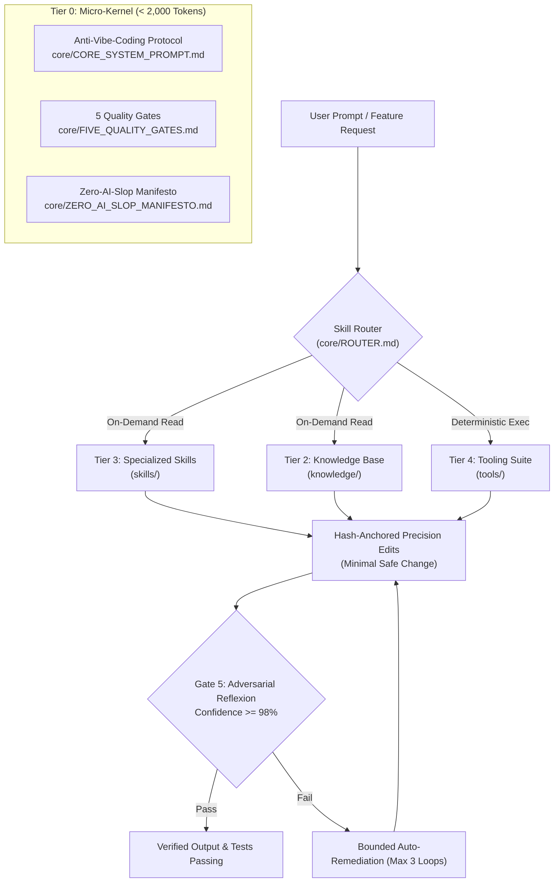

# OverhaulMyAgent ⚡

> **The Deterministic, Anti-Vibe-Coding, and Token-Efficient AI Agent Operating System**  
> *Transform any LLM into a disciplined, evidence-based Senior Staff Software Engineer.*

[](LICENSE)
[](https://agents.md/)
[](#multi-harness-support)
[](#progressive-disclosure-for-lightweight-models)
[](#security--zero-leakage-guarantee)

---

## English

### 1. Overview & Problem Statement

Most AI coding workflows suffer from **Vibe Coding**: speculative patching, hallucinated method signatures, context amnesia, conversational sycophancy, and massive token waste. When fed tens of thousands of lines of instructions, lightweight or frontier models experience "Lost in the Middle" syndrome, degrading output fidelity.

**OverhaulMyAgent** solves this by establishing a disciplined, modular, and sensory-motor agent operating harness. It equips AI models across any IDE or terminal with:
1. **Deterministic Anti-Vibe-Coding Protocol:** Bounded execution, verified evidence before mutations, and minimal safe changes.
2. **The 5 Quality Gates:** Spec-Kit, DDIA microservice isolation, concurrency/locking architecture, atomic bottom-up execution, and adversarial reflexion loops.
3. **Progressive Disclosure:** A lightweight kernel (< 2,000 tokens) coupled with an on-demand routing index. Lightweight models (GPT-4o-mini/Luna, Claude Sonnet, Qwen 2.5, DeepSeek Flash, Gemini Flash) load only what they need when they need it.
4. **Deterministic Tooling Suite:** Offloading complex calculations, web scraping, OCR, and colorimetry to deterministic local scripts rather than fragile LLM guessing.
5. **Multi-Harness Portability:** Out-of-the-box adapters for Cursor, Antigravity, Claude Code, Kiro, Qoder, DeepSeek Harness (OMP), and OpenAI Codex.

---

### 2. Core Architecture



---

### 3. Multi-Harness Support

OverhaulMyAgent supports every modern agent harness natively:

| Harness / Platform | Primary Configuration File | Integration Mode |
| :--- | :--- | :--- |
| **OpenAI Codex / Devin / Open Standard** | `AGENTS.md` | Root open standard specification |
| **Cursor IDE** | `.cursorrules` & `.cursor/rules/*.mdc` | Modular rules with glob targeting |
| **Claude Code & Claude Desktop** | `CLAUDE.md` & `mcp/claude_desktop_config.template.json` | Native instruction file & MCP |
| **Google Antigravity & Gemini CLI** | `GEMINI.md`, `skills/`, `knowledge/` | Native Antigravity skill architecture |
| **Kiro Harness** | `kiro.json` | Agent profile & tool binding schema |
| **Qoder Desktop & CLI** | `QODER.md`, `.qoder-plugin/plugin.json` & `mcp/qoder_settings.template.json` | Native local-plugin architecture (skills + knowledge + memory contract) |
| **DeepSeek Terminal Harness & OMP** | `deepseek_harness.md` | Hashline edits & LSP diagnostic loop |
| **ChatGPT Web & Desktop Apps** | `chatgpt_custom_instructions.md` | Two-box custom instructions |

---

### 4. Progressive Disclosure for Lightweight Models

Lightweight models (GPT-4o-mini / Luna, Claude Sonnet / Haiku, Qwen 2.5, DeepSeek Flash, Gemini Flash) often suffer when 50,000 tokens of rules are injected at once.

OverhaulMyAgent uses **Progressive Disclosure**:
- **Boot Payload:** Ingest only `core/CORE_SYSTEM_PROMPT.md` and `core/ROUTER.md` (~2,500 tokens total).
- **On-Demand Dispatch:** When the model detects a specific task (e.g., UI design, financial math, debugging), it reads *only* that specific file:
  - Designing UI: reads `skills/anti-slop-ui-design/SKILL.md`
  - Refactoring >2 files: reads `skills/plan-first/SKILL.md`
  - Resolving bugs: reads `skills/systematic-debugging/SKILL.md`
  - Financial calculations: executes `tools/financial_calculator.py`
  - Web scraping: executes `tools/fetch_web.py`

---

### 5. Deterministic Tooling Suite

Never let an LLM do raw math or parse messy regex when deterministic code exists:
- `rtk.py`: Proxy compression tool cutting command and test outputs by 60%–98%.
- `fetch_web.py`: Deterministic web content scraper with Trafilatura and markdown conversion.
- `financial_calculator.py`: Institutional-grade financial calculator (waterfalls, compound interest, debt snowball/avalanche).
- `financial_mcp_server.py`: Model Context Protocol server exposing financial calculation endpoints.
- `doc_converter.py`: Local document converter and OCR processor for scanned PDFs and images.
- `macos-ocr.swift`: Apple Silicon Vision OCR tool executing in < 500ms via Metal.
- `monitor_color_tool.py`: Hardware-level DDC/CI monitor calibration and CIEDE2000 color auditing.
- `game_mod_tool.py`: Transactional mod installer enforcing SHA-256 rollback and game compatibility.
- `nvapp_mcp.py`: NVIDIA App MCP wrapper for zero-nausea game optimization and FOV tuning.
- `corporate_firewall.py`: Executive communication transformer (1-3-1 escalations, BLUF summaries).
- `compress_prompt.py`: Token compressor stripping fluff and optimizing whitespace.
- `openspec_tool.py`: Spec-Driven Development (OpenSpec) validator.

---

### 6. Quickstart & Installation

#### Automatic Deployment
Deploy to any project directory with our setup script:

```bash
# Clone the repository
git clone https://github.com/YOUR_USERNAME/OverhaulMyAgent.git
cd OverhaulMyAgent

# Deploy to a project (all harnesses)
python install/setup_harness.py --target all --dir /path/to/your/project

# Or deploy specifically for Cursor
python install/setup_harness.py --target cursor --dir /path/to/your/project

# Or deploy specifically for Claude Code
python install/setup_harness.py --target claude --dir /path/to/your/project

# Or deploy specifically for Qoder (project-scope QODER.md + .qoder/)
python install/setup_harness.py --target qoder --dir /path/to/your/project
```

#### Global Agent Installation
- **macOS / Linux:**
  ```bash
  chmod +x install/install.sh
  ./install/install.sh
  ```
- **Windows (PowerShell):**
  ```powershell
  Set-ExecutionPolicy -Scope Process -ExecutionPolicy Bypass
  .\install\install.ps1
  ```

#### Qoder Installation (user scope)
Installs this repository as a Qoder local plugin — skills, knowledge, tools and
the `core/` micro-kernel — then registers and enables it in `~/.qoder`:

- **macOS / Linux:**
  ```bash
  chmod +x install/install_qoder.sh
  ./install/install_qoder.sh --dry-run   # preview the plan first
  ./install/install_qoder.sh
  ```
- **Windows (PowerShell):**
  ```powershell
  Set-ExecutionPolicy -Scope Process -ExecutionPolicy Bypass
  .\install\install_qoder.ps1 -DryRun
  .\install\install_qoder.ps1
  ```

The installer merges `installed_plugins_v2.json` and `settings.json` instead of
overwriting them, keeps timestamped `.bak_qoder_install_*` backups, and always
writes `settings.json` as UTF-8 **without** a BOM (a BOM makes Qoder reject the
file with `SETTINGS_JSON_INVALID` and silently disables every MCP server).
MCP servers are never auto-installed — copy what you need from
`mcp/qoder_settings.template.json` and fill in your own tokens.
**Restart Qoder** afterwards so the plugin loads. See [`QODER.md`](QODER.md).

---

### 7. Security & Zero-Leakage Guarantee

OverhaulMyAgent is built with privacy-first engineering:
- **Zero Personal Identifiers:** All personal identities, hardware serials, and local user paths are stripped.
- **Zero Leaked Credentials:** No API keys, session tokens, or private endpoints. MCP configs are distributed as clean `.template.json` files.
- **Continuous Red-Team CI:** Automated GitHub Actions linter asserts 0 matches against sensitive regex patterns on every push and PR.
- **Publishing Gate:** `tools/qoder_hub_sync.py` keeps a private agent install and this public repository in sync without ever leaking. It redacts home paths and the operator's name, refuses denylisted and hand-sanitised ("frozen") paths, quarantines anything containing a credential, intranet host, private IP, or internal system name, and stores rejected material **outside** the git working tree. A whole-repository scan runs before every commit; one finding aborts the push.

---

<br/>

---

## Bahasa Indonesia

### 1. Ringkasan & Latar Belakang Masalah

Mayoritas alur kerja AI coding saat ini terjebak dalam fenomena **Vibe Coding**: melakukan patch spekulatif tanpa membaca kode yang ada, menebak signature fungsi/API, mengalami amnesia konteks, bersikap menjilat (*sycophancy*), dan membuang-buang token. Ketika diberikan puluhan ribu baris instruksi sekaligus, model AI ringan maupun frontier sering mengalami degradasi perhatian (*Lost in the Middle*).

**OverhaulMyAgent** diciptakan untuk merevolusi ekosistem agen AI menjadi disiplin, deterministik, dan efisien. Sistem operasi harness ini melengkapi AI di berbagai editor (IDE) maupun terminal dengan:
1. **Protokol Anti-Vibe-Coding:** Eksekusi berlandaskan bukti (*evidence-based*), membaca kode sebelum melakukan perubahan, dan menerapkan mutasi terkecil yang aman (*smallest safe change*).
2. **5 Quality Gates:** Standardisasi arsitektur menyeluruh mencakup Spec-Kit, isolasi microservice (DDIA), kontrol konkurensi/locking database, eksekusi bottom-up, dan evaluasi refleksi adversarial (*Reflexion*).
3. **Progressive Disclosure:** Kernel super ringan (< 2.000 token) dengan indeks pemanggilan modul sesuai kebutuhan (*on-demand*). Model ringan (GPT-4o-mini/Luna, Claude Sonnet, Qwen 2.5, DeepSeek Flash, Gemini Flash) hanya membaca modul yang relevan sehingga hemat token dan tidak lemot.
4. **Perangkat Deterministik (Tooling Suite):** Menyerahkan perhitungan rumit, ekstraksi web, OCR, dan kalibrasi perangkat keras ke skrip Python/Shell lokal, bukan mengandalkan tebakan LLM.
5. **Portabilitas Multi-Harness:** Mendukung langsung Cursor, Antigravity, Claude Code, Kiro, Qoder, DeepSeek Harness (OMP), dan OpenAI Codex.

---

### 2. Arsitektur 5 Quality Gates

Setiap modifikasi arsitektur atau kode penting melewati 5 gerbang kendali mutu:
- **Gate 1 (Blast Radius Discovery):** Memetakan radius dampak perubahan pada 3 dimensi: Langsung (file/tabel/endpoint), Tidak Langsung (pemanggil/shared libs), dan Operasional (migrasi/rollback).
- **Gate 2 (Ketahanan Sistem Terdistribusi):** Diagram urutan (sequence diagram), kontrak skema ketat, isolasi database tanpa cross-JOIN, idempotensi, pola *Transactional Outbox*, dan penanganan timeout jaringan.
- **Gate 3 (Arsitektur Database & Konkurensi):** Verifikasi urutan indeks komposit, nol query N+1 (batching), transaksi pendek (DILARANG memanggil network/HTTP di dalam transaksi database), dan penguncian konkurensi (pessimistic/optimistic lock).
- **Gate 4 (Eksekusi Bottom-Up Atomik):** Implementasi bertahap: Layer 1 (Entitas) -> Layer 2 (Repository/Kueri) -> Layer 3 (Service/Logika Bisnis) -> Layer 4 (Controller/API) -> Layer 5 (Pengujian).
- **Gate 5 (Adversarial Reflexion Review):** Evaluasi mandiri yang kritis sebelum menyerahkan hasil. Wajib mencapai tingkat keyakinan (confidence score) minimal 98%.

---

### 3. Kompatibilitas Multi-Harness

OverhaulMyAgent dirancang agar langsung dapat digunakan di berbagai harness tanpa perlu konfigurasi ulang yang rumit:

| Harness / Editor | Berkas Konfigurasi Utama | Cara Kerja |
| :--- | :--- | :--- |
| **OpenAI Codex / Devin / Standard Terbuka** | `AGENTS.md` | Standar resmi Agentic AI Foundation (AAIF) |
| **Cursor IDE** | `.cursorrules` & `.cursor/rules/*.mdc` | Aturan modular otomatis berbasis pola file |
| **Claude Code & Claude Desktop** | `CLAUDE.md` & `mcp/claude_desktop_config.template.json` | Konfigurasi bawaan Claude Code CLI & Desktop |
| **Google Antigravity & Gemini CLI** | `GEMINI.md`, `skills/`, `knowledge/` | Format bawaan ekosistem Antigravity |
| **Kiro Agent Harness** | `kiro.json` | Profil kapabilitas dan registri tools |
| **Qoder Desktop & CLI** | `QODER.md`, `.qoder-plugin/plugin.json` & `mcp/qoder_settings.template.json` | Arsitektur plugin lokal bawaan (skills + knowledge + kontrak memory) |
| **DeepSeek Terminal Harness & OMP** | `deepseek_harness.md` | Edit presisi hashline dan diagnostik LSP in-process |
| **ChatGPT Web & Aplikasi Desktop** | `chatgpt_custom_instructions.md` | Format dua kotak instruksi khusus |

---

### 4. Arsitektur Hemat Token untuk Model Ringan

Model ringan (GPT-4o-mini / Luna, Claude Sonnet / Haiku, Qwen 2.5, DeepSeek Flash, Gemini Flash) memiliki batasan efisiensi konteks.

OverhaulMyAgent menerapkan sistem **Progressive Disclosure**:
- **Beban Awal:** Hanya memuat `core/CORE_SYSTEM_PROMPT.md` dan `core/ROUTER.md` (total ~2.500 token).
- **Pemanggilan On-Demand:** Ketika ada tugas spesifik, AI hanya membaca 1 file modul yang bersangkutan:
  - Merancang UI: membaca `skills/anti-slop-ui-design/SKILL.md`
  - Merencanakan fitur baru: membaca `skills/plan-first/SKILL.md`
  - Menyelidiki bug / crash: membaca `skills/systematic-debugging/SKILL.md`
  - Menghitung finansial: menjalankan `tools/financial_calculator.py`
  - Mengambil isi URL: menjalankan `tools/fetch_web.py`

---

### 5. Panduan Instalasi Cepat

#### Menggunakan Skrip Penyiapan Otomatis
Terapkan ke proyek apapun dengan satu perintah:

```bash
# Clone repositori
git clone https://github.com/YOUR_USERNAME/OverhaulMyAgent.git
cd OverhaulMyAgent

# Pasang ke proyek Anda (semua harness)
python install/setup_harness.py --target all --dir /path/ke/proyek/anda

# Atau khusus untuk Cursor
python install/setup_harness.py --target cursor --dir /path/ke/proyek/anda

# Atau khusus untuk Claude Code
python install/setup_harness.py --target claude --dir /path/ke/proyek/anda

# Atau khusus untuk Qoder (QODER.md + .qoder/ level proyek)
python install/setup_harness.py --target qoder --dir /path/ke/proyek/anda
```

#### Pemasangan Global ke Sistem
- **macOS / Linux:**
  ```bash
  chmod +x install/install.sh
  ./install/install.sh
  ```
- **Windows (PowerShell):**
  ```powershell
  Set-ExecutionPolicy -Scope Process -ExecutionPolicy Bypass
  .\install\install.ps1
  ```

#### Pemasangan Qoder (level user)
Memasang repositori ini sebagai plugin lokal Qoder — skills, knowledge, tools,
dan micro-kernel `core/` — lalu mendaftarkan sekaligus mengaktifkannya di `~/.qoder`:

- **macOS / Linux:**
  ```bash
  chmod +x install/install_qoder.sh
  ./install/install_qoder.sh --dry-run   # lihat rencananya lebih dulu
  ./install/install_qoder.sh
  ```
- **Windows (PowerShell):**
  ```powershell
  Set-ExecutionPolicy -Scope Process -ExecutionPolicy Bypass
  .\install\install_qoder.ps1 -DryRun
  .\install\install_qoder.ps1
  ```

Installer ini **menggabungkan** (bukan menimpa) `installed_plugins_v2.json` dan
`settings.json`, menyimpan cadangan `.bak_qoder_install_*`, dan selalu menulis
`settings.json` sebagai UTF-8 **tanpa BOM** — adanya BOM membuat Qoder menolak
file dengan `SETTINGS_JSON_INVALID` dan menonaktifkan semua MCP server secara
diam-diam. MCP server tidak pernah dipasang otomatis; salin yang Anda butuhkan
dari `mcp/qoder_settings.template.json` lalu isi token Anda sendiri.
**Restart Qoder** setelah instalasi agar plugin termuat. Lihat [`QODER.md`](QODER.md).

---

### 6. Jaminan Keamanan & Privasi 100%

OverhaulMyAgent memprioritaskan keamanan informasi:
- **Tanpa Identitas Pribadi:** Semua nama pribadi, nomor seri perangkat keras, dan path komputer lokal telah dibersihkan secara otomatis.
- **Tanpa Kredensial / Token:** Tidak ada API key, token otentikasi, maupun rahasia sistem. Konfigurasi MCP didistribusikan dalam bentuk template bersih (`mcp_config.template.json`).
- **Pemeriksaan Keamanan CI/CD:** Dilengkapi pipeline otomatis GitHub Actions yang memvalidasi bahwa tidak ada pola data sensitif yang lolos ke repositori publik.
- **Gerbang Publikasi:** `tools/qoder_hub_sync.py` menjaga instalasi agen privat dan repositori publik ini tetap sinkron tanpa kebocoran. Skrip ini menyamarkan path home dan nama operator, menolak path yang masuk daftar larangan maupun yang disanitasi manual ("frozen"), mengarantina berkas yang memuat kredensial, host intranet, IP privat, atau nama sistem internal, dan menyimpan materi yang ditolak **di luar** working tree git. Pemindaian seluruh repositori dijalankan sebelum setiap commit; satu temuan saja membatalkan push.

---

## Lisensi / License

Didistribusikan di bawah lisensi terbuka [MIT License](LICENSE).