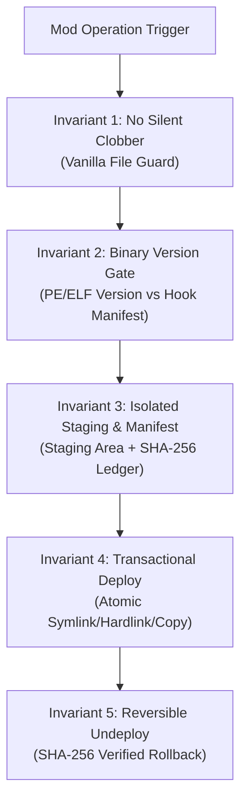

# Automated Game Modding & Safety Engine Architecture

## 1. Executive Summary & Core Philosophy

The **Automated Game Modding & Safety Engine** provides an autonomous, deterministic, and non-destructive workflow for discovering games, resolving mod dependency trees, staging mod archives, validating binary compatibility, deploying mods with transactional rollback safety, and facilitating live in-game editing via runtime injection bridges.

This system guarantees **zero game corruption**, **zero unrecoverable crashes**, and **deterministic rollback** across major distribution platforms (Steam, Epic Games Store, GOG Galaxy, and Xbox Game Pass).

---

## 2. The 5 Safety Invariants (Strict Non-Destructive Modding)

Every automated modding operation orchestrated by Gemi must strictly adhere to these 5 invariants:



1. **Invariant 1: No Silent Clobber (Zero Vanilla File Overwrite)**
   - Never write to, modify, or overwrite original vanilla game files shipped by Steam, Epic Games, or GOG (e.g., base `.pak`, `.bundle`, `.bsa`, `common.redscripts`, or main game executables).
   - All modifications must live as isolated runtime plugins, script directories, virtual hardlinks, or isolated data overrides.
2. **Invariant 2: Binary Version Gate (Strict PE/Changelist Matching)**
   - Game executables (e.g., `Cyberpunk2077.exe`, `SkyrimSE.exe`, `Bannerlord.exe`) have exact file versions and product builds. Native DLL mods (`RED4ext.dll`, `SKSE.dll`, `F4SE.dll`, `BepInEx`) bind directly to memory addresses that shift with each official patch.
   - Before deploying any native hook or DLL, verify that the game's `FileVersion` and `ProductVersion` match the mod's target version.
3. **Invariant 3: Isolated Staging & Dependency Tree Resolution**
   - Never extract an untrusted archive directly into a game directory.
   - Archives are always unpacked into an isolated staging directory (`~/.gemini/staging/<game>/<mod_id>/`).
   - The dependency tree (e.g., Mod requires Mod Settings -> Codeware -> ArchiveXL -> redscript -> RED4ext) must be recursively resolved and validated before deployment.
4. **Invariant 4: Transactional Journaling (`mod_manifest.json`)**
   - Before modifying the destination folder, write a transactional manifest containing:
     - Mod name, version, source archive hash
     - Target game path and executable build
     - Every relative file path and its expected SHA-256 checksum
     - Backup path for any existing modified files
   - If an error occurs midway, perform an automatic atomic rollback.
5. **Invariant 5: Non-Destructive Override Patching & SHA-256 Undeploy**
   - When tuning or customizing an installed mod (e.g., adjusting weapon stats or lighting curves), never mutate the original mod source files. Generate a higher-priority "Override Patch" or custom config file.
   - During undeployment, check the file's current SHA-256 against the manifest. If a user or editor modified the file in-place, move it to a safe `user_overrides/` folder rather than deleting it.

---

## 3. Cross-Launcher Game Discovery Protocol

### 3.1. Steam Architecture
- **Library Folders**: Read `C:\Program Files (x86)\Steam\steamapps\libraryfolders.vdf` (or parse all drives `[A-Z]:\SteamLibrary\steamapps\libraryfolders.vdf`).
- **App Manifest**: Look for `appmanifest_<AppID>.acf`:
  - `Cyberpunk 2077`: AppID `1091500`
  - `Skyrim Special Edition`: AppID `489830`
  - `Red Dead Redemption 2`: AppID `1174180`
  - `Mount & Blade II: Bannerlord`: AppID `261550`
  - `Total War: Warhammer III`: AppID `1142710`
  - `The Witcher 3`: AppID `292030`
- Extract `installdir` and `buildid`. The game directory is `steamapps/common/<installdir>`.

### 3.2. Epic Games Store Architecture
- Scan manifests at `C:\ProgramData\Epic\EpicGamesLauncher\Data\Manifests\*.item` (JSON format).
- Parse keys: `DisplayName`, `InstallLocation`, `LaunchExecutable`, `AppVersionString`.

### 3.3. GOG Galaxy Architecture
- Query Windows Registry:
  `HKLM\SOFTWARE\WOW6432Node\GOG.com\Games\<GameID>` -> `path` and `version`.

### 3.4. Xbox Game Pass (UWP / Windows Store)
- Inspect `.GamingRoot` on all mounted drives and `C:\Program Files\WindowsApps\` via PowerShell `Get-AppxPackage`.

---

## 4. Mod Acquisition & Nexus Mods API Protocol

### 4.1. Nexus Mods API Authentication & Security Constraints
- **Authentication Method**: Nexus Mods REST API (v1) and GraphQL (v2) require a **Personal API Key** passed via the HTTP Header:
  ```http
  GET /v1/users/validate.json HTTP/1.1
  Host: api.nexusmods.com
  apikey: <USER_PERSONAL_API_KEY>
  Application-Name: Gemi-Automated-Modding-Engine
  Application-Version: 1.0.0
  ```
- **Security Rule on Credentials**: Nexus Mods deliberately does not support HTTP POST username/password login endpoints due to Cloudflare Turnstile, CAPTCHA, and credential stuffing defenses. Storing raw plaintext passwords in code is strictly prohibited.
- **How to Obtain Personal API Key**:
  1. Log into Nexus Mods in a web browser.
  2. Visit [Nexus Mods API Account Settings](https://www.nexusmods.com/users/myaccount?tab=api).
  3. Scroll to the **"Personal API Key"** section and click **"Generate"**.
  4. Store the API key in the environment or agent config (`NEXUS_API_KEY`).
- **Free Tier vs Premium Constraints**:
  - Direct download links (`/download_link.json`) are officially unlocked for **Nexus Premium** accounts.
  - For **Free Accounts**: Use browser hand-off or the `nxm://` URL handler protocol, or manual download to the staging folder followed by automated transactional staging and deployment.

### 4.2. Nexus Mods MCP Server Integration
- **Primary Package**: `@ubermorgott/nexusmods-mcp-server` or `171county/modwrench`.
- **MCP Configuration (`mcp.json`)**:
  ```json
  {
    "mcpServers": {
      "nexusmods": {
        "command": "cmd",
        "args": ["/c", "npx", "-y", "@ubermorgott/nexusmods-mcp-server"],
        "env": {
          "NEXUS_API_KEY": "YOUR_PERSONAL_API_KEY"
        }
      },
      "modwrench": {
        "command": "cmd",
        "args": ["/c", "npx", "-y", "@modwrench/cli"],
        "env": {
          "NEXUS_API_KEY": "YOUR_PERSONAL_API_KEY"
        }
      }
    }
  }
  ```

---

## 5. Staging, FOMOD Parsing & Dependency Resolution

### 5.1. FOMOD ModuleConfig Parsing
Large mods distribute options using FOMOD (`fomod/ModuleConfig.xml`):
1. **Unpack to Staging**: Extract the zip/7z/rar archive to `~/.gemini/staging/<mod_id>`.
2. **Inspect FOMOD XML**:
   - `<requiredInstallFiles>`: Files that must always be installed.
   - `<installSteps>` -> `<group>` -> `<plugins>`: Mutually exclusive or optional configurations (e.g., 2K vs 4K textures, weather presets, compatibility patches).
   - `<fileDependency>`: Conditions checking whether prerequisite mods or game patches exist.
3. **Deterministic Selection**: Match the user's active mod list, screen resolution, and hardware budget (e.g., select High/1080p/1440p textures over bloated 4K/8K uncompressed meshes to protect VRAM and avoid stutter).

### 5.2. Dependency Tree Graph
Before installing any mod:
- Query mod requirements via Nexus API (`related_mods` / dependencies).
- Validate framework availability:
  - **Cyberpunk 2077**: RED4ext, redscript, ArchiveXL, TweakXL, Codeware, Mod Settings.
  - **Skyrim SE / Fallout 4**: SKSE64 / F4SE, Address Library for SKSE Plugins, PapyrusUtil, SkyUI.
  - **Bannerlord**: Harmony, ButterLib, UIExtenderEx, Mod Configuration Menu (MCM).
  - **Unity Games**: BepInEx, Harmony, ConfigurationManager.
  - **Unreal Engine**: RE-UE4SS, UE4SS Lua API.

---

## 6. Live In-Game Editing & Runtime Injection Bridges

When requested to customize or live-tune mods in-game:
1. **Bethesda (Skyrim/Fallout)**: Use Mutagen (`Mutagen-Modding/Mutagen`) to generate dynamic `.esp` override plugins programmatically without touching source records.
2. **Unity Games**: Utilize BepInEx + Harmony runtime patches or IPC bridge sockets on `127.0.0.1` to hot-reload variables.
3. **Unreal Engine Games**: Connect to RE-UE4SS via local TCP/WebSocket socket to manipulate live actor properties and dump Blueprints.
4. **REDengine (Cyberpunk 2077)**: Utilize `Mod Settings` and dynamic `.reds` observer methods to adjust variables in memory without restarting the game.

---

## 7. Open-Source Ecosystem & Scientific Literature References

### 7.1. Key Open-Source Projects
- `erri120/GameFinder`: Multi-launcher detection engine (.NET / C#).
- `Nexus-Mods/NexusMods.App`: Next-gen official Nexus mod manager (Rust / Avalonia).
- `Nexus-Mods/Vortex`: Standard mod manager with modular game extensions.
- `ParkerrDev/Modrix`: Cross-platform Rust mod manager with built-in MCP server (`modrix mcp`).
- `wabbajack-tools/wabbajack`: Automated binary diff patching and curated modlist pipeline.
- `loot/libloot`: Graph-based plugin conflict and load-order topological sorter.

### 7.2. Scientific Literature & Academic Papers
1. **Lee et al. (2021)**: *"Building the Perfect Game – An Empirical Study of Game Modifications"*, Empirical Software Engineering / arXiv:2103.07528. Analyzes mod release lifecycles, dependency co-evolution, and crash causality across thousands of Nexus mods.
2. **Scacchi (2010)**: *"Computer Game Mods, Modders, Modding, and the Mod Scene"*, University of California, Irvine. Formalizes closed-source software extension patterns, asset redirection hooks, and domain-specific scripting bindings.
3. **Wang et al. (2023)**: *"Voyager: An Open-Ended Embodied Agent with Large Language Models"*, arXiv:2305.16291. Seminal benchmark demonstrating how LLM agents write, verify, and persist executable game modification skills with feedback loops.
4. **Gregory (2018)**: *"Game Engine Architecture"*, 3rd Edition, CRC Press. Foundational reference on Virtual File Systems (VFS), runtime resource loading, DLL hook injection, and dynamic scripting bindings.
