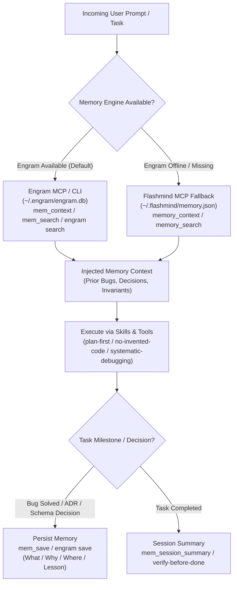

# Flashmind Smart Agent Architecture: Gemini 3.8 Flash Persistent Memory & Anti-Hallucination Engine

> **Reference Repository:** [Hvftpie13/Flashmind_Gemini-3.8-Flash_Smart-agent](https://github.com/Hvftpie13/Flashmind_Gemini-3.8-Flash_Smart-agent)  
> **Permanent Local Path:** `<HOME>\.gemini\flashmind`  
> **Engram Engine:** `<HOME>\.gemini\bin\engram.exe` (`v3.6.0`, database at `~/.engram/engram.db`)  
> **Flashmind Fallback Engine:** `<HOME>\.gemini\flashmind\server\index.js` (database at `~/.flashmind/memory.json`)

---

## 1. Executive Summary & Core Objective

Gemini 3.8 Flash (High) is an exceptionally fast, highly capable reasoning engine with a large context window. However, in long-horizon programming sessions, fast models suffer from three distinct failure modes:
1. **Context Amnesia & Lost-in-the-Middle:** Forgetting past architectural decisions, re-asking previously resolved questions, or losing track of established invariants across context window resets or compactions.
2. **Hallucinated Symbols & APIs:** Inventing non-existent packages, deprecated methods, false CLI flags, or hallucinated database schema columns.
3. **Premature Victory ("Vibe-Fixed"):** Declaring a bug fixed or a feature completed without executing real builds, unit tests, or verifying the runtime diff.

**Flashmind solves this through a deterministic three-layer stack:**
- **Layer 1: Shared Persistent Memory (Engram + Flashmind stdio MCP):** Dual-tier storage that persists atomic project decisions, bug lessons, and user preferences across turns, IDE restarts, and context compactions.
- **Layer 2: Strict Anti-Hallucination Guardrails (`GEMINI.md` / `AGENTS.md`):** Rigorous separation of verified facts from assumptions and explicit unknowns.
- **Layer 3: Four Proactive Agent Skills:** Automated SOPs dynamically loaded on demand (`plan-first`, `no-invented-code`, `systematic-debugging`, `verify-before-done`).

---

## 2. Dual Memory Architecture: Engram & Flashmind Fallback



### 2.1. Engram Primary Engine (`engram.exe`)
- **Backend:** Go-based SQLite engine with FTS5 keyword indexing, vector search, and conflict detection.
- **Location:** `<HOME>\.gemini\bin\engram.exe`.
- **Database:** `<HOME>\.engram\engram.db`.
- **Primary MCP Tools (23 tools in `--tools=agent` profile):**
  - `mem_context`: Fetches recent and high-priority observations across projects.
  - `mem_search`: FTS5 search across all past observations.
  - `mem_save`: Persists atomic observations with project and topic tags.
  - `mem_session_summary`: Persists session summaries across compactions.
  - `mem_doctor` / `mem_consolidate`: Audits and merges legacy or duplicate memories.
- **CLI Commands (Direct execution without MCP):**
  ```powershell
  # Search memories across all projects
  engram search "motion sickness" --all

  # Save an observation
  engram save "Title" "Detailed message" --project <name> --scope <project|global>

  # Inspect database health and statistics
  engram stats
  engram context
  ```

### 2.2. Flashmind Fallback Engine (`server/index.js`)
- **Backend:** Zero-dependency Node.js MCP server using BM25-lite keyword ranking and atomic file writing.
- **Location:** `<HOME>\.gemini\flashmind\server\index.js`.
- **Database:** `<HOME>\.flashmind\memory.json`.
- **Tools:** `memory_context`, `memory_search`, `memory_save`, `memory_get`, `memory_list`, `memory_update`, `memory_delete`, `memory_verify`.
- **Invariant:** When Engram is active, observations are saved primarily to Engram to prevent duplicate storage.

---

## 3. The 4 Proactive Agent Skills

Flashmind enforces 4 proactive skills located in `~/.gemini/config/skills/` and `~/.agents/skills/`:

### 3.1. `plan-first`
- **Activation:** Any coding task with $> 3$ steps or touching multiple files.
- **Protocol:**
  1. Load context via `mem_context` / `mem_search`.
  2. Clarify only blocking ambiguities with the user.
  3. Draft a 3–7 step plan with explicit verification criteria per step.
  4. Execute one step at a time, verifying before advancing to the next.
  5. Refuse speculative refactoring outside task scope.

### 3.2. `no-invented-code`
- **Activation:** Writing or modifying imports, library calls, CLI flags, configuration keys, or environment variables.
- **Protocol:**
  1. Inspect local repository files using bounded reads (`grep`, symbol lookup).
  2. Verify installed package versions against dependency manifests (`package.json`, `go.mod`, `pom.xml`, `pyproject.toml`).
  3. Verify against vendor source in `node_modules` / cache or official docs.
  4. Red flags: guessing helper function names, mixing SDK versions, or assuming flags exist without `--help`.

### 3.3. `systematic-debugging`
- **Activation:** Errors, crashes, test failures, or broken behavior.
- **Protocol:**
  1. Check past memories (`mem_search` / `engram search`) for identical or similar symptoms.
  2. Reproduce the failure with the smallest standalone command or test case.
  3. Locate the error from the top frame in **project source code** (not external libraries).
  4. State root cause in one sentence: *"It fails because ___"* with evidence.
  5. Implement minimal fix without silencing errors (`catch {}`, `|| true`, `skip`).
  6. Prove reproduction passes and persist lesson to memory (`Title`, `What`, `Why`, `Where`, `Lesson`).

### 3.4. `verify-before-done`
- **Activation:** Before declaring any task finished, fixed, or passing.
- **Protocol:**
  1. Identify real project commands from manifests or CI scripts.
  2. Execute sequentially: compile/typecheck -> linter -> targeted tests -> app smoke check.
  3. Audit actual terminal stdout/stderr: exit code `0` with "0 tests ran" is a failure.
  4. Re-read `git diff` to eliminate debug logs, lingering TODOs, and unintentional edits.
  5. Format delivery report: **Changed**, **Verified**, **Not verified**.

---

## 4. Epistemic Classification & Anti-Hallucination Rules

Every assertion emitted by Gemi must belong to one of three strictly distinct categories:
- **Verified Fact:** Backed by tangible inspected source code, execution log, or persistent memory record. Cited with `filename:line_number`, test output, or observation ID.
- **Assumption:** Inferred hypothesis or probabilistic expectation. Must be explicitly prefixed: *"Assumption / Unverified hypothesis: ... "*.
- **Unknown:** Information not present in code, memory, or documentation. Must be declared plainly: *"Unknown: I do not know / no evidence found in repo."*

---

## 5. Security & PII Protection Invariant

Never persist sensitive credentials to Engram or Flashmind memory:
- API Keys (`AIza*`, `ghp_*`, `sk-*`, `Bearer *`)
- Private keys, tokens, or credentials (`BEGIN PRIVATE KEY`, `password: *`)
- Financial identifiers (Credit card numbers, bank accounts, national IDs)
- All secrets must be scrubbed with `<REDACTED>` before calling persistence tools.
