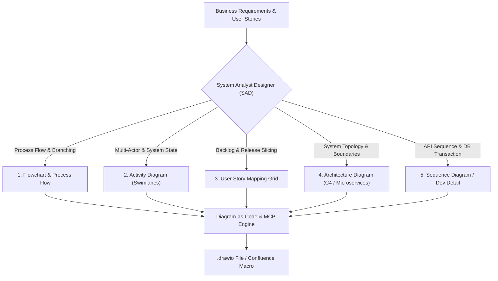
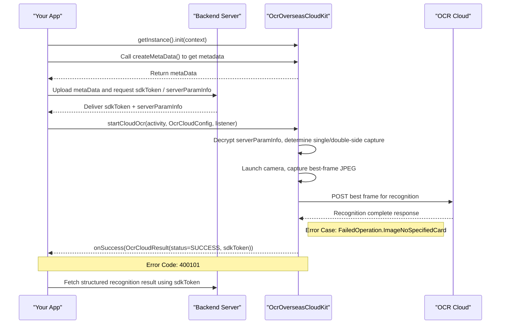

# System Analyst Designer (SAD) Diagramming & Diagram-as-Code (DaC) Architecture

## 1. Core Mental Model: System Analyst Designer (SAD) in Banking & Microservices

As a **System Analyst Designer (SAD)**, the core responsibility is bridging the business domain (Product Managers, Business Owners, Compliance, Fraud, Security) with technical implementation realities (Backend Engineers, Mobile/Frontend Engineers, DevOps, QA, DBA).

Diagrams and specifications produced by a System Analyst Designer are not passive visual illustrations; they are **System Specification Contracts** governing test criteria, architectural boundaries, and operational risk mitigation.

### 1.1. Fundamental Failure Modes of LLMs with Raw `.drawio` (XML mxGraphModel)
When LLMs attempt to generate raw Draw.io XML (`<mxGraphModel>`), common failure patterns emerge:
1. **Coordinate Hallucination:** Lacking 2D spatial awareness, AI randomly guesses geometry coordinates (`x`, `y`, `width`, `height`), resulting in overlapping nodes, clipped text, and illegible canvases.
2. **Edge Routing Chaos:** Connectors slice through intermediate boxes diagonally, anchor points miss shape boundaries, and routing lacks orthogonal discipline.
3. **XML Syntax Fragility:** Broken closing tags or unescaped entities (`&quot;`, `&lt;`, `&gt;`) corrupt Draw.io parsing and break Confluence page rendering.

### 1.2. Strategic Architecture: Diagram-as-Code (DaC) & Declarative Layout
To produce deterministic, enterprise-grade diagrams programmatically, Gemi enforces a **Diagram-as-Code (DaC)** lifecycle:
1. **Phase 1 (Declarative Specification First):** Formulate logic, state transitions, and swimlanes using declarative languages like **Mermaid.js**, **PlantUML**, or **Structurizr DSL** to validate flows with stakeholders.
2. **Phase 2 (Programmatic Layout Engine):** Utilize code-based toolkits (Python scripts like `drawpyo`, `mingrammer/diagrams`, or Draw.io MCP tools) to compute geometry, margins, grid alignment, and orthogonal routing mathematically.
3. **Phase 3 (Confluence Macro & Storage Integration):** Store diagrams as `.drawio` / `.drawio.xml` files following squad naming conventions and embed them via Confluence Draw.io Macros (`<ac:structured-macro ac:name="drawio">`), preserving revision history and editable vectors.

---

## 2. Taxonomy & Standards for the 5 System Analyst Diagram Types



### 2.1. Flowchart & Business Process Flow
- **Purpose:** Map business decision trees and error recovery sequentially from entry trigger to terminal states.
- **Component Primitives:**
  - *Start / Entry Point:* Rounded Pill (Green `#d5e8d4`).
  - *Process Step:* Rounded Rectangle (Blue `#dae8fc`).
  - *Decision Node:* Rhombus (Yellow/Gold `#fff2cc`) with explicit branch labels (`Yes`/`No`, `Valid`/`Invalid`).
  - *Sub-process / Service Call:* Box with dual border or service badge.
  - *End / Terminal State:* Success (Green `#d5e8d4`) or Error/Exit (Red `#f8cecc`).
- **Ergonomic Invariant:** Primary happy paths progress vertically (Top-to-Bottom) or horizontally (Left-to-Right). Exception and error flows branch outward to the right or bottom.

### 2.2. Activity Diagram (Swimlanes / Responsibility Partitions)
- **Purpose:** Detail cross-system orchestration across distinct security and technical boundaries (critical for onboarding, migration, and authentication flows).
- **Standard 5 Banking Swimlanes (Enterprise Banking / Corporate Services):**
  1. `User / Customer`: Physical client interactions (app open, OTP input, biometric capture, KTP photo).
  2. `Frontend (iOS / Android / Web)`: Client validation, payload encryption, request debouncing, API Gateway dispatch.
  3. `API Gateway (API Gateway)`: Routing, session validation, rate limiting, request aggregation.
  4. `Core Microservices (onboarding_service / Ledger / Reporting / Identity)`: State machine validation, transactional writes, credential verification, audit logging.
  5. `External / Third Parties (Identity Provider / eKYC Vendor A / eKYC Vendor B / eKYC Vendor C / Enterprise Service Bus / Kafka)`: Identity verification, biometric liveness, digital signatures, async event publishing.
- **DaC Best Practice:** Prototype using PlantUML (`|Swimlane|`) or Mermaid (`subgraph`), then convert to Draw.io swimlane objects.

### 2.3. User Story Mapping Grid
- **Purpose:** Align feature delivery roadmaps into clear release slices (MVP / Release 1 vs Release 2).
- **2D Grid Structure:**
  - **Horizontal Axis (User Journey Backbone):** Chronological user activities/epics (e.g., *Registration -> Identity Verification -> Credential Setup -> Completion*).
  - **Vertical Axis (Priority / Release Slices):**
    - *Walking Skeleton / MVP:* Minimal end-to-end operable flow.
    - *Release 1 (Core Enhancement):* Primary features (biometric login, e-sign).
    - *Release 2 (Edge Cases & Optimizations):* Self-service retries, fallback handling.

### 2.4. System Architecture Diagram (C4 Model & Microservice Topology)
- **Purpose:** Provide layered system visualization with explicit architectural boundaries.
- **C4 Model Levels:**
  1. *Context (Level 1):* Enterprise system scope and actors (Customer, Enterprise Mobile App, Core Banking, ESB, Identity Provider).
  2. *Container (Level 2):* Deployable services, gateways, databases, message brokers, object storage.
  3. *Component (Level 3):* Internal service architecture (Clean Architecture: Controllers, Use Cases, Repositories, Entities).
  4. *Code (Level 4):* Class structures and database ERD schemas.

### 2.5. Sequence Diagram / Development Detail (Section 5 FRD)
- **Purpose:** Microsecond-level technical endpoint contracts and chronological inter-system messaging for engineering implementation.
- **1. Chronological Lifelines & Participant Order (Left to Right):**
  - Participants MUST be explicitly declared at the top in chronological invocation order:
    `Actor / User` $\rightarrow$ `Client App (Frontend/Mobile)` $\rightarrow$ `Internal Gateway / Backend (API Gateway/onboarding_service)` $\rightarrow$ `Supporting SDK / Local Library` $\rightarrow$ `External Cloud / Third Party / Database`.
- **2. Arrow Semantics & Communication Types:**
  - `->>` (Solid Line with Arrowhead): Synchronous HTTP/gRPC requests, method/function calls, or trigger events.
  - `-->>` (Dashed Line with Arrowhead): Return values, HTTP responses, or callback listeners.
  - `A->>A:` (Self-Message / Reflexive Arrow): Crucial internal processing inside a single component (e.g. payload encryption/decryption, camera frame capture, local format validation).
- **3. Dual-Context Labeling (Business Verb + Technical Contract):**
  - Every arrow label MUST concisely combine the business action with technical contracts (max 8–10 words per line).
  - *Good:* `Upload metaData and request sdkToken / serverParamInfo`
  - *Good:* `startCloudOcr(activity, OcrCloudConfig, listener)`
  - *Bad:* `Call API` (too vague) or dumping large JSON payloads directly on arrows.
- **4. Error Codes & Exception Mapping:**
  - Negative cases, HTTP 4xx/5xx status codes, and vendor error codes MUST be mapped using `Note over` or `Note right of` directly attached below the corresponding response arrow (e.g., `Note right of SDK: Error Case: FailedOperation.ImageNoSpecifiedCard` and `Note over App,SDK: Error Code: 400101`).



---

## 3. Tooling Ecosystem, MCP Servers & DaC Libraries

### 3.1. Official Draw.io MCP & Tools Ecosystem
| Repository / Tool | Source / URL | Core SAD Capabilities & Integration |
| :--- | :--- | :--- |
| **`jgraph/drawio-mcp`** | `https://github.com/jgraph/drawio-mcp` | **Official Draw.io MCP Server & Plugin**. Generates native `.drawio` files and exports editable `.drawio.png`.<br>• Install as Antigravity plugin: `agy plugin install https://github.com/jgraph/drawio-mcp/tree/main/plugins/antigravity`<br>• Run via NPX: `npx @drawio/mcp`<br>• LLM Reference Guides: `shared/mermaid-reference.md` and `shared/xml-reference.md`. |
| **`mermaid-js/mermaid-cli`** | `https://github.com/mermaid-js/mermaid-cli` | Command-line compiler for syntax validation and automated rendering:<br>`npx @mermaid-js/mermaid-cli -i diagram.mmd -o diagram.png -t dark`.<br>Produces line-numbered error traces enabling deterministic agent self-correction. Live Playground: `https://mermaid.live`. |
| **`yuzutech/kroki`** | `https://github.com/yuzutech/kroki` / `https://kroki.io` | Unified multi-format rendering API converting Mermaid, PlantUML, BlockDiag, C4, and GraphViz directly into SVG/PNG. Ideal for automated FRD build pipelines. |
| `sparklabx/drawio-ai-kit` | `https://github.com/sparklabx/drawio-ai-kit` | Declarative layout engine with BPMN/Cloud shapes and mathematical coordinate validation to prevent overlapping nodes. |
| `DayuanJiang/next-ai-draw-io` | `https://github.com/DayuanJiang/next-ai-draw-io` | Interactive Draw.io canvas generator: `npx @next-ai-drawio/mcp-server@latest`. |
| `aws-samples/sample-drawio-mcp` | `https://github.com/aws-samples/sample-drawio-mcp` | TypeScript/Node.js JSAPI to manipulate mxGraph XML structures programmatically. |

### 3.2. Confluence & Jira MCP Integrations
| Repository | GitHub URL | Description & Benefits |
| :--- | :--- | :--- |
| `sooperset/mcp-atlassian` | `https://github.com/sooperset/mcp-atlassian` | Standard MCP server for Jira and Confluence. Parses Jira tickets/stories, updates Confluence pages programmatically. |
| `drawio-confluence` Skill | `https://skills.rest/skill/drawio-confluence` | Automated workflow to download `.drawio` attachments from Confluence, modify flows, and upload versioned attachments with macro updates. |

### 3.3. Python Libraries for Programmatic DaC
| Library / Package | Repository / Link | Usage Scope |
| :--- | :--- | :--- |
| `drawpyo` | `https://github.com/MerrimanInd/drawpyo` | Pure Python `.drawio` generation. Builds tree diagrams, grid layouts, and styled shapes with zero raw XML editing. |
| `diagrams` | `https://github.com/mingrammer/diagrams` | Industry standard for architecture diagrams via Python. Renders Kubernetes, AWS, GCP, and on-premise topologies. |
| `structurizr/dsl` | `https://github.com/structurizr/dsl` | Canonical text-based C4 Model standard with export options to Draw.io, PlantUML, and Mermaid. |

---

## 4. Draw.io Anti-Error Parser Rules (Crucial Guardrails)

The Draw.io Mermaid parser is stricter than standard Markdown viewers. To guarantee 100% zero-parse-error conversion when importing into Draw.io Confluence:

1. **Rule 1 (Participant IDs):** Never use hyphens or unquoted special characters in participant IDs (e.g. `participant Your-App` breaks the parser). Use clean, single-word alphanumeric identifiers and assign display titles using aliases:
   - *Wrong:* `participant Your-App`
   - *Correct:* `participant App as "Your App"`
2. **Rule 2 (One Statement per Line):** Strictly emit one statement per line. Never chain sequence operations with semicolons (`;`). Always use explicit newlines.
3. **Rule 3 (No Raw Curly Braces in Labels):** Avoid raw curly braces `{}` or double colons `::` inside message arrow labels (e.g. `onSuccess(Result{status=SUCCESS})`). Replace with regular parentheses `(status=SUCCESS)` or wrap the entire label string in double quotes.
4. **Rule 4 (Strictly Restricted HTML):** Use `<br/>` strictly when line wrapping is necessary inside notes or arrow labels. Never embed arbitrary HTML tags (`<div>`, `<span>`, `<b>`), as Draw.io will either ignore them or fail parsing.

---

## 5. Visual Standards & Draw.io Semantic Design Tokens

### 5.1. Semantic Color Palette (Hex Tokens)

| Semantic Category | Fill Color (`fillColor`) | Stroke Color (`strokeColor`) | Text Color | Example Elements |
| :--- | :---: | :---: | :---: | :--- |
| **Start / Success / Terminal OK** | `#d5e8d4` | `#82b366` | `#274e13` | Start node, RC `00`, Verification Passed, Active State |
| **Process / Action / Internal Service** | `#dae8fc` | `#6c8ebf` | `#1c3b70` | Microservice step, Data Hashing, State Mutation |
| **Decision / Conditional Branching** | `#fff2cc` | `#d6b656` | `#7f6000` | Status Check, PIN Validation, User Exists Check |
| **End / Failure / Exception State** | `#f8cecc` | `#b85450` | `#660000` | Rejection, RC `SM`, Fraud Alert, Error Exception |
| **Database / Persistence / Caching** | `#e1d5e7` | `#9673a6` | `#351c75` | MySQL `onboarding_db`, `ibank`, Redis Cache |
| **External Service / Third Party** | `#ffe6cc` | `#d79b00` | `#783f04` | Identity Provider, eKYC Vendor A, eKYC Vendor B, eKYC Vendor C, CASA ESB |
| **Message Broker / Async Worker** | `#f5f5f5` | `#666666` | `#333333` | RabbitMQ queue, Kafka topic, Async Worker |

### 5.2. Shape Stylesheet Properties (`style` attribute)
- **Standard Process Step:** `rounded=1;whiteSpace=wrap;html=1;arcSize=12;`
- **Decision Node:** `rhombus;whiteSpace=wrap;html=1;`
- **Database / Persistent Store:** `shape=cylinder3;whiteSpace=wrap;html=1;boundedLbl=1;backgroundOutline=1;size=15;`
- **Document / PDF / Form:** `shape=document;whiteSpace=wrap;html=1;boundedLbl=1;size=0.27;`
- **Actor / User:** `shape=umlActor;verticalLabelPosition=bottom;verticalAlign=top;html=1;outlineConnect=0;`
- **Swimlane Container:** `swimlane;whiteSpace=wrap;html=1;startSize=28;horizontal=1;collapsible=0;`
- **Mandatory Orthogonal Connectors:** `edgeStyle=orthogonalEdgeStyle;rounded=0;orthogonalLoop=1;jettySize=auto;html=1;strokeColor=#565656;` *(MANDATORY: Prevents diagonal lines slicing through intermediate nodes)*.

---

## 6. The 3 Confluence & Draw.io Production Integration Workflows

### Workflow 1: Direct Mermaid Copy-Paste (Fastest Native Conversion)
1. Gemi generates declarative `sequenceDiagram` Mermaid syntax adhering to the Anti-Error rules.
2. In Confluence: Type `/drawio` to insert a Draw.io macro.
3. In the Draw.io editor top menu: Select **Arrange (Atur) > Insert (Sisipkan) > Advanced (Lanjutan) > Mermaid...**
4. Paste the Mermaid code and click **Insert**.
5. Result: Draw.io automatically parses the code into native, fully editable visual vector shapes and lifelines.

### Workflow 2: Programmatic `.drawio` File Import (Zero Manual Configuration)
1. Agent generates a complete `.drawio` file locally using Python `drawpyo` or Draw.io MCP:
   Prompt: *"Create sequence diagram for OCR onboarding flow and save as `squad-sequencediagram-ocr.drawio`"*.
2. In Confluence: Open the Draw.io macro editor, click **File > Import from > Device**, and select the generated `.drawio` file.
3. Save and publish the Confluence page.

### Workflow 3: Editable Image Export (`.drawio.png` with Embedded XML)
1. Using the Draw.io CLI / MCP with the `--embed-diagram` flag:
   The exported PNG contains the complete XML diagram structure embedded inside PNG metadata chunks.
2. When pasted or inserted into Confluence, viewers see a sharp image, but any team member can reopen and edit the diagram directly inside Draw.io without losing layers or vector definitions.

### 6.1. Squad Attachment Naming Convention
Diagrams uploaded to Confluence follow squad naming conventions:
```text
squad-<diagram_type>-<feature_kebab_case>.drawio
```
Examples:
- `squad-flowchart-sample-feature.drawio`
- `squad-activitydiagram-fast-migration.drawio`
- `squad-architecture-vendor-liveness.drawio`
- `squad-sequencediagram-ocr-onboarding.drawio`

### 6.2. Confluence Storage Format (XHTML)
```xml
<p>
  <ac:structured-macro ac:name="drawio">
    <ac:parameter ac:name="diagramName">squad-sequencediagram-ocr-onboarding</ac:parameter>
    <ac:parameter ac:name="revision">1</ac:parameter>
    <ac:parameter ac:name="pageId">123456780</ac:parameter>
    <ac:parameter ac:name="simple">true</ac:parameter>
  </ac:structured-macro>
</p>
```

---

## 7. Python Generator Template (`drawpyo` / Script DaC)

```python
"""
Activity Diagram Generator using drawpyo.
Generates mathematically valid .drawio files without coordinate collisions.
"""
import drawpyo
from drawpyo.diagram_types import TreeDiagram

def generate_activity_diagram(output_path):
    diagram = drawpyo.File()
    page = diagram.add_page(name="Activity Flow")
    
    tree = TreeDiagram(
        direction="down",
        level_spacing=80,
        item_spacing=60
    )
    
    start_node = drawpyo.diagram.Node(
        value="Start (User Initiates Feature)",
        width=160, height=50,
        base_style="rounded=1;whiteSpace=wrap;html=1;fillColor=#d5e8d4;strokeColor=#82b366;"
    )
    
    check_node = drawpyo.diagram.Node(
        value="Verify User Status in Redis",
        width=160, height=50,
        base_style="rounded=1;whiteSpace=wrap;html=1;fillColor=#dae8fc;strokeColor=#6c8ebf;"
    )
    
    decision_node = drawpyo.diagram.Node(
        value="Does CIF Exist?",
        width=120, height=60,
        base_style="rhombus;whiteSpace=wrap;html=1;fillColor=#fff2cc;strokeColor=#d6b656;"
    )
    
    tree.add_node(start_node)
    tree.add_node(check_node, parent=start_node)
    tree.add_node(decision_node, parent=check_node)
    
    diagram.write(output_path)
    print(f"Diagram successfully generated at: {output_path}")

if __name__ == "__main__":
    generate_activity_diagram("squad-flowchart-sample.drawio")
```


---

## 8. Confluence Architecture Diagram Standards ("Anti-Ribet" Component Topology)

### 8.1. The 5-Layer Anti-Pattern vs. Clean Component Topology
When designing architecture diagrams for Functional Requirement Documents (FRDs) in banking systems (such as Enterprise Mobile App and Corporate Gateway), a major anti-pattern is the **Over-Engineered 5-Layer Diagram**:
- **Why it fails:** 40+ nested boxes, arbitrary layer swimlanes (Client, API Gateway, Core Microservices, External Layer, Storage Layer), paragraphs of explanatory text, and cluttered crisscrossing connection lines. This creates overwhelming cognitive fatigue, becomes completely illegible when embedded inside Confluence expand macros, and is rejected by engineers and product owners.
- **The "Anti-Ribet" Standard (Reference Gold Standard - Page ID `123456700`):** A clean, component-level topology focused strictly on active actors, primary gateways, central microservices, fast cache, and persistent storage, contained within an uncluttered canvas.

```
       [Partner Server]  (e.g., Vendor / InternalPlatform)
              ⇅
         [API_GATEWAY]       (Enterprise Customer Gateway #f8cecc)
              ⇅
[API_GATEWAY] ➔ [customer-onboarding-service] ⇄ [Redis] (In-memory cache)
(API Gateway) (Core Microservice)
              ⇅           ↘
        [db onboarding_db]   [document-signing-service / partner-ca]
       (Relational Storage) (Digisign Microservice / CA Gateway)
```

### 8.2. The 4-Quadrant Topological Grid (`521x508`)
The industry standard for FRD Section 2 architecture diagrams follows a 4-quadrant layout with fixed dimensions (`521` width, `508` height):

| Quadrant | Role & Components | Draw.io Shape / Style | Coordinates & Purpose |
| :--- | :--- | :--- | :--- |
| **Top / Top-Left (Q1)** | External Partner Server & Enterprise Gateway | `generic_server.svg` (Partner) $\leftrightarrow$ `shape=mxgraph.aws3.customer_gateway;fillColor=#f8cecc;strokeColor=#b85450;` (`API_GATEWAY`) | Partner server communicates bidirectionally through enterprise gateway (`API_GATEWAY`) into core banking backend. |
| **Left (Q3)** | Reverse Proxy & API Gateway | `generic_server.svg` (`API Gateway`) | Primary ingestion point for mobile client requests, routing traffic into internal microservices. |
| **Center** | Core Onboarding Microservice | `image=img/lib/ibm/applications/microservice.svg;` (`customer-onboarding-service`) | The central state orchestrator coordinating onboarding, KYC validation, token caching, and event dispatch. |
| **Top-Right (Q2)** | High-Speed Cache & Session Store | `image=img/lib/mscae/Cache_Redis_Product.svg;` (`Redis`) | Short-lived cache for OTP sessions, partner tokens, and rate-limiting flags. |
| **Right / Downstream (Q4)** | Specialized Microservices & Partner Integrations | `microservice.svg` (`document-signing-service` / `push-notification-service`) and `customer_gateway` (`partner-ca` / `ESB`) | Async event consumers (e.g. RabbitMQ / Kafka) handling digital signatures and push notifications. |
| **Bottom (Q4)** | Relational Persistence | `image=img/lib/active_directory/databases.svg;` (`db onboarding_db`) | Persistent MySQL storage for customer onboarding records and parameter configurations. |

### 8.3. Confluence Macro Storage Contract for Architecture Diagrams
```xml
<h2>Architecture Diagram</h2>
<ac:structured-macro ac:name="expand" ac:schema-version="1">
  <ac:parameter ac:name="title">Click here to show architecture diagram...</ac:parameter>
  <ac:rich-text-body>
    <p>
      <ac:structured-macro ac:name="drawio" ac:schema-version="1">
        <ac:parameter ac:name="border">true</ac:parameter>
        <ac:parameter ac:name="diagramName">{diagramName}</ac:parameter>
        <ac:parameter ac:name="simpleViewer">false</ac:parameter>
        <ac:parameter ac:name="links">auto</ac:parameter>
        <ac:parameter ac:name="tbstyle">top</ac:parameter>
        <ac:parameter ac:name="lbox">true</ac:parameter>
        <ac:parameter ac:name="diagramWidth">521</ac:parameter>
        <ac:parameter ac:name="height">508</ac:parameter>
        <ac:parameter ac:name="revision">{revision}</ac:parameter>
      </ac:structured-macro>
    </p>
  </ac:rich-text-body>
</ac:structured-macro>
```

---

## 9. Confluence Activity Diagram Standards ("Baik & Benar" Lifeline Model)

### 9.1. Structural Lifelines & Swimlane Partitioning
Activity Diagrams in Section 3 of banking FRDs follow a **Multi-Phase Lifeline Hybrid** (`width: 2300`, `height: 4280` or proportional):
1. **Vertical Lifelines (Left to Right):**
   - Lifeline 1: `User / Nasabah` (Client actor)
   - Lifeline 2: `Mobile App / Frontend` (e.g. `Enterprise Mobile App`)
   - Lifeline 3: `Core Microservice` (e.g. `customer-onboarding-service`)
   - Lifeline 4: `Partner SDK / Internal Worker` (e.g. `Vendor SDK` / `document-signing-service`)
   - Lifeline 5: `External Partner / Gateway` (e.g. `Vendor Cloud` / `Partner CA`)
2. **Horizontal Phase Grouping:**
   - Group lifecycle stages into distinct horizontal sections (e.g. *Phase 1: Inisialisasi*, *Phase 2: OCR & Liveness Verification*, *Phase 3: Face Comparison STC*, *Phase 4: Digital Signature*).
3. **Delta / Scope Change Highlighting (Mandatory):**
   - New or modified logic introduced by the FRD must be encased in a distinct dashed red container:
     `fillColor=#fee2e2;strokeColor=#ef4444;strokeWidth=2;strokeDasharray=6 4;fillOpacity=0.6;`
   - Header badge for modified scope: `fillColor=#ef4444;fontColor=#ffffff;fontStyle=1;`
   - Explicit introductory text preceding the expand macro: `<p>Perubahan pada section yg berwarna merah</p>`.

---

## 10. Confluence Draw.io Server Mechanics & Troubleshooting Traps

### 10.1. Trap 1: The "Stuck Revision" Viewer Bug
- **Symptom:** You upload a new attachment (e.g., Version 2 or Version 3) to Confluence, but when you open or refresh the Confluence page, it stubbornly continues rendering the old, outdated diagram.
- **Root Cause:** Confluence Draw.io macros explicitly store `<ac:parameter ac:name="revision">X</ac:parameter>` in the page storage XHTML. The client-side Draw.io plugin reads this parameter and sends an API call for `attachment?version=X`. If `revision` is left at `1`, Confluence **will never load Version 2 or 3**, regardless of how many new files you upload!
- **Remediation:**
  1. Inspect `body.view` and decode `data-diagramdata` base64 string to check the active `revision`.
  2. Use `python confluence_drawio_tool.py set-revision --page-id <id> --name <diagram_name> --revision <new_version>` to update the storage parameter cleanly.

### 10.2. Trap 2: Attachment Duplication HTTP 400
- **Symptom:** `urllib.error.HTTPError: HTTP Error 400: Cannot add a new attachment with same file name as an existing attachment`.
- **Root Cause:** In Atlassian Confluence Server REST API, `POST /rest/api/content/{page_id}/child/attachment` is strictly for **creating brand new attachments**. If an attachment with the same filename already exists on the page, the API rejects the request with HTTP 400.
- **Remediation:**
  1. Query existing attachments via `GET /rest/api/content/{page_id}/child/attachment`.
  2. For existing files, upload binary updates to:
     `POST /rest/api/content/{page_id}/child/attachment/{attachment_id}/data` with header `X-Atlassian-Token: nocheck`.

### 10.3. Trap 3: Storage XHTML Tag Nesting & Unclosed Blocks
- **Symptom:** Confluence rejects page update with `HTTP 400: Unexpected close tag </ac:layout>; expected </ac:structured-macro>`.
- **Root Cause:** FRD Section 2 is frequently wrapped inside an info macro (`<ac:structured-macro ac:name="info">`). Naive regex replacements that overwrite closing tags corrupt the XML stack.
- **Remediation:** Always parse or match the exact tag hierarchy and ensure all `</ac:rich-text-body></ac:structured-macro>` tags remain properly balanced.

### 10.4. Dual-Attachment Protocol & Visual Fidelity ("Anti-Burik")
Confluence Draw.io requires **two attachments per diagram**:
1. `{diagram_name}`: Content-Type `application/vnd.jgraph.mxfile` (NO `.xml` extension in title).
2. `{diagram_name}.png`: Content-Type `image/png` (rendered at 2x viewport scale for crisp Retina display).

### 10.5. Apple Silicon Vision OCR Pre-Flight Check
Before publishing, run the native macOS Vision tool to verify that all text labels and component names are rendered crisply without clipping or typos:
```bash
ocr path/to/diagram.png
```

---

## 11. Production Tooling & Automation (`confluence_drawio_tool.py`)

A centralized Python automation tool is located at `~/.gemini/scripts/confluence_drawio_tool.py`.

### 11.1. CLI Commands Reference

```bash
# 1. Update Macro Revision Directly (Fixes 'Stuck Revision' Trap)
python ~/.gemini/scripts/confluence_drawio_tool.py set-revision \
  --page-id 123456789 \
  --name architecture-diagram-partner-onboarding \
  --revision 2

# 2. Upload Dual Attachments (Auto-handles new vs existing update)
python ~/.gemini/scripts/confluence_drawio_tool.py upload \
  --page-id 123456789 \
  --xml ./arch.xml \
  --png ./arch.png \
  --name architecture-diagram-partner-onboarding

# 3. Inject Macro (Activity or Arch)
python ~/.gemini/scripts/confluence_drawio_tool.py inject \
  --page-id 123456789 \
  --name architecture-diagram-partner-onboarding \
  --type arch \
  --revision 2

# 4. One-Shot Publish (Upload + Inject + Verify)
python ~/.gemini/scripts/confluence_drawio_tool.py publish \
  --page-id 123456789 \
  --xml ./activity.xml \
  --png ./activity.png \
  --name activity-diagram-partner-onboarding \
  --type activity

# 5. Deep Verification of Rendered View HTML
python ~/.gemini/scripts/confluence_drawio_tool.py verify \
  --page-id 123456789
```

### 11.2. Headless Browser SVG-to-PNG Rendering
To guarantee crisp high-fidelity PNG rendering without blurring:
```bash
/Applications/Opera.app/Contents/MacOS/Opera --headless --disable-gpu \
  --window-size=2300,4280 --screenshot=activity.png file:///path/to/preview.html
```
