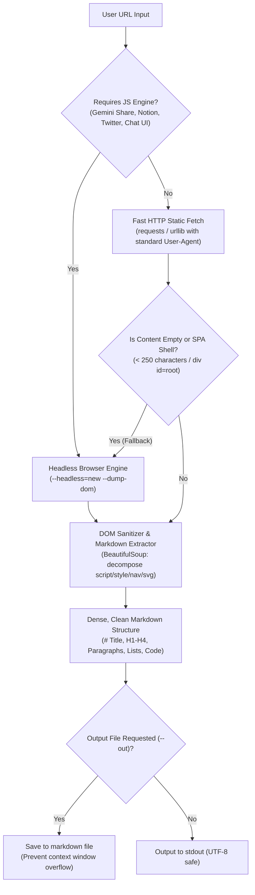

# Zero-Lag Web Content Extraction & Reading Protocol

Technical architecture and operating guidelines for Gemi to extract, ingest, and analyze web link content instantly without trial-and-error, eliminating context token waste.

---

## 1. Problem Statement & Root Cause of Slow Web Fetching

When users provide web links (especially Google Gemini Share, Notion, Twitter/X, modern news articles, or React/Vue/Angular dashboards):
1. **Single Page Application (SPA) / Client-Side Rendering:**
   Raw HTTP responses (`curl`) only return empty JavaScript bundles (`<div id="root"></div>` or large `<script>` tags). Article text is not populated before JavaScript execution in a browser engine.
2. **Redirects & Dynamic Data:**
   Services like `share.gemini.google` issue 301 redirects to `gemini.google.com/share/...`, which hydrates conversations via Web Components.
3. **Encoding & Token Bloat:**
   Ad-hoc shell commands like `curl` or dumping raw HTML into terminal sessions cause:
   - *UnicodeEncodeError* on Windows terminals (CP1252 / `charmap`).
   - Massive token waste (10,000–50,000 tokens) if full unparsed 1.5MB HTML is injected into the context window.
   - High latency (10–15 trial-and-error turns).

---

## 2. Deterministic Solution: `fetch_web.py`

Gemi uses a deterministic single-step CLI tool:
`<HOME>/.gemini/scripts/fetch_web.py`

### Execution Architecture:


---

## 3. Operating Rules for Gemi

1. **Strictly Forbidden: Trial-and-Error Ad-Hoc Scripts:**
   Whenever User provides a web link or requests article ingestion from a URL, Gemi must **NEVER** write ad-hoc curl scripts, manual regex parsers, or inspect raw HTML iteratively.
2. **Execute Single-Command Tool Directly:**
   Run directly via `run_command`:
   ```bash
   # Short articles / direct terminal analysis:
   python3 <HOME>/.gemini/scripts/fetch_web.py "<URL>" --max-chars 8000

   # Long pages / large documentation (token-saving file output):
   python3 <HOME>/.gemini/scripts/fetch_web.py "<URL>" --out "<HOME>/.gemini/antigravity/scratch/scraped_page.md"
   ```
3. **Structured JSON Output (Optional):**
   When structured metadata is needed (title, description, raw length, truncated flag):
   ```bash
   python3 <HOME>/.gemini/scripts/fetch_web.py "<URL>" --json
   ```
4. **Speed & Efficiency:**
   - Static pages: Completes in 1–2 seconds.
   - Heavy JavaScript / SPA pages (Gemini Share, Notion): Completes cleanly in 5–7 seconds in a single turn.
