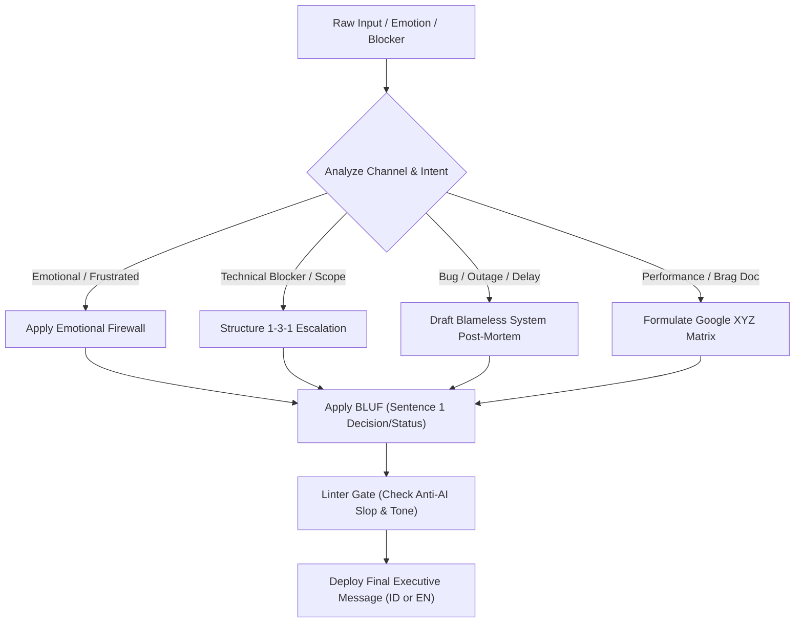

# Corporate Diplomacy & Career Acceleration Skill

Use this skill whenever User or an engineering agent needs to:
1. **Manage Up & Communicate with Leadership:** Write emails, Slack/Teams updates, memos, or project status reports that exhibit executive presence.
2. **Engage the Emotional Firewall:** Filter out frustration, exhaustion, irritability, or panic when drafting responses to sudden scope changes, impossible deadlines, or team friction.
3. **Escalate Blockers (1-3-1 Protocol):** Present 1 core problem, 3 viable options with trade-offs, and 1 concrete recommendation.
4. **Draft Blameless Incident Reports:** Frame bugs, delays, and outages as system/process opportunities rather than individual incompetence.
5. **Formulate High-Impact Performance Metrics:** Quantify achievements for 1-on-1s, quarterly reviews, and promo packets using Google's XYZ formula.

---

## 1. Operational Workflow



---

## 2. Execution Protocols

### Protocol A: The Emotional Firewall
When the user's initial draft or prompt expresses irritation, defensiveness, or exhaustion:
1. **Extract Core Facts:** Strip out complaints, blaming, and emotional commentary. Isolate the factual delta (timeline, resource constraint, architecture risk).
2. **Preserve Agency & Face:** Frame boundaries not as refusal, but as informed choices for leadership (*"We can do A on Friday, or include B and deliver next Tuesday. Which is the top priority for leadership?"*).
3. **Calibrate Tone:**
   - **Indonesian:** Respectful, composed, polite yet firm (*santun, solutif, lugas*).
   - **English:** Crisp, assertive, solution-first (*executive composure*).

### Protocol B: 1-3-1 Escalation
Structure all upward escalations with the 1-3-1 pattern:
```text
[Subject / Header]: [Action Required] Project X - [Brief Issue]

1. Core Problem:
   [1-2 sentences stating the blocker, quantifiable blast radius, and customer/timeline impact]

2. Solution Options & Trade-offs:
   • Option A (Fast / Containment): [Action] -> Trade-off: [Time/Cost/Tech Debt]
   • Option B (Optimal Architecture): [Action] -> Trade-off: [Time/Cost/Tech Debt]
   • Option C (Scope Reduction): [Action] -> Trade-off: [Time/Cost/Tech Debt]

3. Recommendation:
   We recommend Option B because [justification]. Unless you advise otherwise, the team will proceed with Option B by [Time/Date].
```

### Protocol C: Blameless System Post-Mortem
Never point fingers at developers, clients, or third parties. Frame failures through systemic resilience:
```text
• Impact: [Quantifiable downtime, error rate, or delay]
• Systemic Root Cause: [Validation gap, race condition, or specification ambiguity]
• Immediate Containment: [Hotfix or workaround currently active]
• Long-Term Guardrail: [Automated CI check, rate limiter, or pre-sprint checklist deployed]
```

### Protocol D: Google XYZ Performance Reporting
Transform subjective hard work into undeniable executive value:
$$\text{"Accomplished [X] as measured by [Y] by doing [Z]"}$$
- **X (Outcome):** *"Cut database transaction latency"*
- **Y (Metric):** *"by 35% and reduced peak query timeout incidents to zero"*
- **Z (Action):** *"by refactoring composite indexes and tuning connection pool limits."*

---

## 3. Dedicated Local Tooling & Linting

### Pre-Flight Linting Script: `corporate_firewall.py`
Before finalizing any upward draft, execute the corporate firewall utility to check for AI slop and structural compliance:
```powershell
python tools/corporate_firewall.py lint --text "Draft content..."
```

Or execute automated transformations:
```powershell
# Transform raw frustration into executive corporate message
python tools/corporate_firewall.py transform --mode firewall --lang id --text "Ini mendadak banget bos, gak bakal keburu kalau dipaksa minggu ini!"

# Structure a technical blocker into 1-3-1 escalation
python tools/corporate_firewall.py transform --mode 1-3-1 --text "Database dev 18 lemot banget pas dites load test QRIS."

# Structure a brag accomplishment
python tools/corporate_firewall.py transform --mode brag --text "Saya beresin query lambat di service onboarding customer portal."
```

### External MCP Integration: `raven-mcp`
When deep analysis of tone shifts, clarity, and message anatomy is required, query the `raven` MCP server tools:
- `raven:get_content_system`
- `raven:get_content_principles`

---

## 4. Anti-AI Slop Blacklist & Grammar Rules

1. **Banned Words (EN):** *delve, tapestry, testament, beacon, symphony, game-changer, landscape, realm, foster, underscore, pivotal, intricate, unwavering, bespoke*.
2. **Banned Openers (EN):** *"I hope this email finds you well"*, *"In today's fast-paced environment"*.
3. **Banned Words & Openers (ID):** *"Dalam lanskap yang terus berkembang"*, *"Penting untuk dicatat bahwa"*, *"Hal ini menjadi bukti nyata"*, *"Permadani"*, *"Menyelami lebih dalam"*.
4. **No False Contrasts:** Strictly ban *"It's not just about X, it's about Y"* or *"Bukan sekadar X, melainkan Y"*.
5. **Punctuation Budget:** Maximum 1 em-dash (—) per email. Zero full-sentence bolding.
