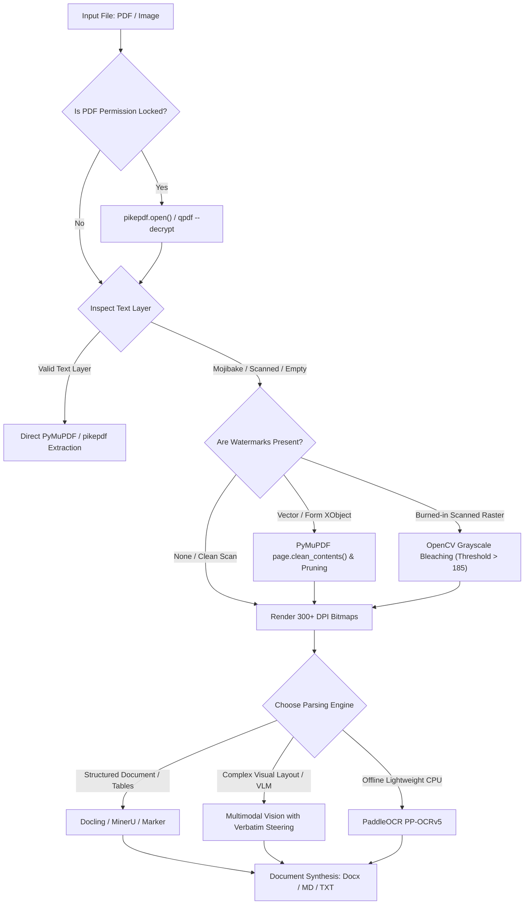

# High-Precision Document OCR & Format Conversion Skill

Use this skill whenever User requests extracting, scanning, reading, or converting documents (PDFs, scans, receipts, contracts, images) into Word (`.docx`), Markdown (`.md`), plain text (`.txt`), or structured JSON—especially when documents are password-locked, copy-restricted, filled with watermarks, or mangled by corrupted font encodings.

---

## 1. Zero-Leakage Privacy Invariant

- **Anti-Web-Converter Rule:** Never upload User's documents to third-party web conversion services or unverified cloud APIs.
- **Local-First Processing:** Process all files locally on the workstation using deterministic Python tools (`pikepdf`, `PyMuPDF`, `OpenCV`, `python-docx`) or local model inferences.
- **Memory & Storage Hygiene:** Intermediate rendered raster pages must reside in temporary memory or project scratch directories and be securely purged upon task completion.

---

## 2. Decision Tree & Execution Pipeline



---

## 3. Four-Step Operational Execution Protocol

### Step 1: Inspection & Instant Permission Unlock
1. Verify if the PDF has copy/print restrictions:
   ```python
   import pikepdf
   with pikepdf.open(input_path) as pdf:
       pdf.save(unlocked_path)
   ```
2. Test Page 1 text stream:
   - If clean text extracts, proceed directly without OCR.
   - If output contains empty glyphs, mojibake symbols (`□□□`), or broken font encodings (corrupted CMap/ToUnicode), bypass the text layer and trigger high-resolution rasterization.

### Step 2: Watermark Elimination
1. **Vector Layers:** Use `fitz` (PyMuPDF) to clean contents and remove `/Artifact` or `/Watermark` XObjects.
2. **Burned-in Raster Watermarks:**
   - Render page at **300 DPI** minimum.
   - Apply OpenCV thresholding to bleach faint/translucent watermarks (brightness > 185) to pure white `#FFFFFF` while preserving dark ink text (brightness < 130).

### Step 3: Engine Selection & Page Chunking
1. **Engine Selection:**
   - For complex multi-column documents with tables: use **Docling** (`uvx --from=docling-mcp docling-mcp-server`) or **MinerU**.
   - For visual ambiguity / heavy stamps: invoke Multimodal Vision LLM (Gemini Flash, Claude 3.5 Sonnet) using the **Verbatim Anti-Hallucination Steering Prompt**.
   - For fully offline fast CPU OCR: execute **PaddleOCR v5**.
2. **Chunking Guardrail:** Never pass more than 3–5 pages simultaneously to an LLM context to prevent truncation or output drift. Process sequentially and merge.

### Step 4: Format Synthesis (`.docx`, `.md`, `.txt`)
1. For Markdown output: ensure standard headings, Markdown tables, and LaTeX math blocks.
2. For Word (`.docx`) output: utilize `python-docx` to map headings, bullet hierarchies, monospace code blocks, and formatted tables with 1-inch margins and clean typography.
3. For Text output: format clean UTF-8 text with preserved paragraph breaks.

---

## 4. Anti-Hallucination Verbatim Steering Prompt

When dispatching document page images to Vision LLMs, prepend this steering prompt:

```markdown
# System Prompt: High-Precision Verbatim OCR & Document Reconstruction

Transcribe all textual, tabular, and structural content from this document page into clean Markdown with 100% accuracy.

Strict Invariants:
1. Verbatim Transcription: Copy words, punctuation, numbers, and symbols exactly as printed. Never summarize, rewrite, or correct original typos.
2. Complete Watermark Suppression: Disregard translucent, diagonal, or background watermark text (e.g. 'CONFIDENTIAL', 'DRAFT', repeated agency names). Never mix watermark words into body text.
3. Anti-Hallucination on Blurred Text: If ink is smudged, torn, or unreadable, write `[illegible]` or `[blurred: possibly '...']`. NEVER guess.
4. Anti-Truncation: Transcribe completely from header to footer without placeholders like `...[continued]...`.
5. Tables & Numbers: Maintain accurate columns and double-check all numeric decimals (.) and thousands separators (,).
```

---

## 5. Verification Checklist (Verify-Before-Done)

Before handing converted documents to User:
- [ ] Decryption verified (no password errors or permission locks).
- [ ] Watermark suppressed (no watermark words leaking into sentences).
- [ ] Number parity verified (financial amounts, dates, and account numbers match the original image).
- [ ] File integrity tested (the generated `.docx` opens cleanly without XML corruption).
