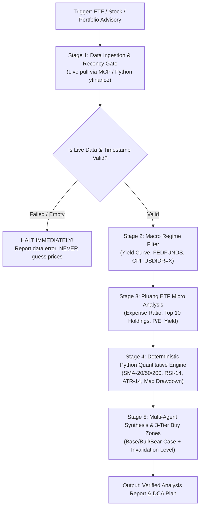

# Financial ETF & Market Advisory Skill (Anti-Vibe Quantitative Framework)

Use this skill whenever receiving requests to analyze US equities, ETFs (specifically within the **Pluang** catalog), macroeconomic trends, or when formulating portfolio allocations and purchase price zones. Strictly eliminates stale price hallucinations, arithmetic inaccuracies in technical indicators, and false precision bias.

---

## 1. Core Workflow: 5-Stage Deterministic Pipeline



---

## 2. Standard Operating Procedures (SOP) by Stage

### Stage 1: Data Ingestion & Recency Gate (HARD GUARDRAIL)
1. **Strictly Forbidden:** Never quote ETF prices, dividend yields, P/E ratios, or economic metrics from internal LLM memory.
2. **Data Pull Execution:** Invoke MCP tools (`yahoo-finance-mcp`, `fred-mcp-server`, `openbb`) or run Python scripts via `yfinance`.
3. **Print Timestamps:** Always log and display `last_updated_timestamp` and the latest US exchange trading date. If markets are closed, use official `previousClose` or `postMarketPrice` and explicitly state the market status.
4. **Fail-Closed Rule:** If the API fails to fetch ticker data, halt analysis for that ticker and report the technical failure. Never fabricate subjective estimates.

### Stage 2: Macro Regime Filter (Top-Down Screening)
Fetch macro indicators via FRED MCP or Yahoo Finance to determine sector allocation bias:
1. **Interest Rates & Yield Curve (`FEDFUNDS`, `DGS10`, `T10Y2Y`):**
   - Rising yields / elevated rates $\rightarrow$ Tech/Growth (`QQQ`, `SMH`) valuation compression; favor Value/Dividends (`SCHD`, `XLF`) or high-yield cash.
   - Flattening/falling yields $\rightarrow$ Tailwind for Tech & Growth.
2. **Inflation & Growth (`CPIAUCSL`, `UNRATE`):**
   - Expansion $\rightarrow$ Core broad indices (`VOO`, `VTI`) & aggressive sectorals (`QQQ`, `XLK`, `SMH`).
   - Slowdown / Recession $\rightarrow$ Defensive sectors (`XLV`, `XLP`), Gold (`GLD`), or US Treasuries (`TLT`).
3. **USD/IDR FX Context (`USDIDR=X`):**
   - Inspect Rupiah strength against USD. If USD/IDR sits near historical highs, alert user to currency conversion risk and advise stepped Dollar Cost Averaging (DCA).

### Stage 3: Micro Analysis & Pluang Universe Validation
1. **Pluang Catalog Check:** Confirm ETF availability on Pluang (e.g., `VOO`, `SPY`, `QQQ`, `VTI`, `DIA`, `IWM`, `SCHD`, `SMH`, `XLK`, `XLF`, `XLV`, `XLE`, `XLP`, `TLT`, `GLD`, `VNQ`, `JEPI`).
2. **Expense Ratio Check:**
   - Passive Core Index: Target $\le 0.10\%$ annually.
   - Sectoral / Thematic: Reasonable ceiling $\le 0.50\%$.
3. **Top 10 Holdings Concentration:**
   - Check if top 3 holdings command $\ge 40\%$ of total ETF assets (e.g., Nvidia & TSMC in `SMH`). If so, flag earnings release volatility risk.
4. **Relative Valuation:**
   - Compare weighted basket P/E ratio against 5-year historical averages.

### Stage 4: Deterministic Python Quantitative Engine
Execute a Python script computing exact metrics over 252 trading days (1 year):
- `current_price`, `52w_high`, `52w_low`, and `pct_from_52w_high`
- Trend Averages: `SMA_20`, `SMA_50`, `SMA_200`
- Momentum & Volatility: `RSI_14` and `ATR_14` (Average True Range)
- Historical Risk: `annualized_volatility` and `max_drawdown_1y`

### Stage 5: Multi-Agent Synthesis & 3-Tier Buy Zones (Anti-False Precision)
1. **Never Give a Single Target Price:** Never state *"The buy target is \$450"*. Markets operate across volatility probability distributions.
2. **Provide 3-Tier Buy Zones (ATR & SMA Based):**
   - **Tier 1 (Light DCA / Momentum Pullback):** Near $\text{SMA}_{20}$ or $P_{\text{close}} - (1.0 \times \text{ATR}_{14})$ (RSI 45–55).
   - **Tier 2 (Core Accumulation / Mean Reversion):** Near $\text{SMA}_{50}$ / Lower Bollinger Band $(20, 2)$, or $P_{\text{close}} - (2.0 \times \text{ATR}_{14})$ (RSI 35–45).
   - **Tier 3 (Deep Discount / Major Historical Support):** Near $\text{SMA}_{200}$ during deep market corrections (RSI $< 35$).
3. **3-Dimensional Scenarios & Invalidation Levels:**
   - **Bull Case:** Revenue growth acceleration and multiple expansion.
   - **Base Case:** Consensus valuation and baseline earnings expectation.
   - **Bear Case:** Macro headwinds or multiple compression.
   - **Invalidation Level:** Technical or fundamental threshold where the investment thesis fails (e.g., confirmed daily close below $\text{SMA}_{200}$).

---

## 3. Negative Constraints

| Prohibition | Technical Rationale | Correct Solution |
| :--- | :--- | :--- |
| **Guessing prices from LLM memory** | Training cutoff hallucination | Pull live API via MCP / Python `yfinance`. |
| **Mental computation of RSI/SMA** | Inaccurate probabilistic math | Execute `pandas_ta` or numpy in Python. |
| **Single absolute target price** | False precision bias | Provide 3-Tier Volatility Buy Zones via ATR. |
| **Ignoring USD/IDR exchange rate** | Pluang investors face dual currency risk | Include `USDIDR=X` and staged DCA recommendations. |
| **Omitting downside risk** | Violates fiduciary risk management | Always include Bear Case & Invalidation Level. |

---

## 4. Standard Report Template

```markdown
# Quantitative ETF Analysis Report: [TICKER] (Pluang Catalog)

### 1. Data Verification & Recency Proof
- **Latest Price (USD):** $... (USD/IDR FX: Rp ... per USD)
- **Estimated Price (IDR):** Rp ... per unit
- **Exchange Timestamp:** YYYY-MM-DD HH:MM UTC (Status: Open / Closed)
- **Data Grounding Source:** yfinance / Yahoo Finance MCP (252-day OHLCV)

### 2. Macro Regime & Sector Climate
- **Monetary Policy & Yields:** FEDFUNDS ...%, 10Y Treasury Yield ...%
- **Sectoral Bias:** [Growth / Value / Defensive]
- **Currency Context:** [Rupiah status & DCA implications]

### 3. ETF Basket Micro Profile
- **Expense Ratio:** ...% (Fair ceiling: ...)
- **Top 3 Holdings:** [Names & Weight %]
- **Concentration Risk:** [Low / Moderate / High]

### 4. Deterministic Quantitative Matrix
| Metric | Value | Interpretation |
| :--- | :--- | :--- |
| Distance from 52W High | ...% | Historical momentum |
| SMA-20 / SMA-50 / SMA-200 | $... / $... / $... | Short, medium, long term trend direction |
| RSI (14-Day) | ... | Momentum & overbought/oversold status |
| ATR (14-Day) | $... | Typical daily volatility range |
| Max Drawdown 1Y | ...% | Historical drawdown risk profile |

### 5. Recommended 3-Tier Buy Zones & DCA Execution
- **Tier 1 (Light DCA / Momentum):** $... (Rp ...)
- **Tier 2 (Core Accumulation / Pullback):** $... (Rp ...)
- **Tier 3 (Deep Discount / Major Support):** $... (Rp ...)

### 6. Investment Scenarios & Risk Boundaries
- **Base Case:** ...
- **Bull Case:** ...
- **Bear Case:** ...
- **Thesis Invalidation Level:** Confirmed close below $...
```
