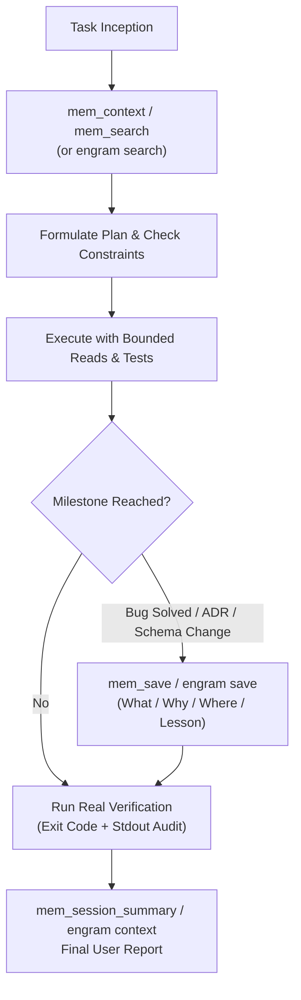

# Flashmind & Engram Persistent Memory Protocol

Flashmind pairs fast LLM execution (Gemini 3.8 Flash) with a deterministic 3-tier memory and verification architecture:
1. **Engram Primary Memory**: SQLite-backed persistent memory engine (`~/.engram/engram.db`) via `engram` CLI and stdio MCP (`--tools=agent`).
2. **Flashmind Fallback Memory**: Zero-dependency JSON memory engine (`~/.flashmind/memory.json`) with BM25-lite keyword ranking.
3. **Epistemic Classification & Anti-Hallucination Guardrails**: Strict tripartite demarcation (Verified Fact vs. Stated Assumption vs. Explicit Unknown).

---

## 1. Memory Operational Lifecycle



### Phase A: Task Inception (Zero-Amnesia Start)
Before touching code or answering queries regarding project architecture, history, or user preferences:
1. If MCP is available, invoke `mem_context` (or `memory_context`).
2. Query specific keywords with `mem_search` or CLI:
   ```powershell
   engram search "<topic or keywords>" --all
   ```
3. If memory returns no hits, state plainly: *"This information is not known yet in memory."* Never hallucinate past history.

### Phase B: Mid-Task Learning Capture (Autonomous Persistence)
Immediately persist facts without waiting for user prompting when:
- **Bug Fixed**: Root cause, reproduction command, and the exact resolution.
- **Architecture Decision (ADR)**: Trade-offs evaluated, chosen library/pattern, and reasons.
- **Gotchas / Library Quirk**: Breaking changes, version incompatibilities, or unusual configuration.

Format for `mem_save`:
```markdown
Title: <Descriptive short title>
What: <Observed symptom or decision context>
Why: <Root cause or architectural rationale>
Where: <File path, line number, or API endpoint>
Lesson: <Actionable advice to prevent recurrence or guide future agents>
```

Using CLI directly from terminal:
```powershell
engram save "<Title>" "<What / Why / Where / Lesson>" --project <project_name> --scope project
```

### Phase C: Context Reset & Session Finalization
1. **Post-Compaction Wakeup**: If context reset or compaction occurs, call `mem_session_summary` or `engram context` immediately to re-anchor lost state.
2. **Session Closure**: Conclude major initiatives by recording session milestones:
   - Accomplished milestones
   - Remaining tasks / next steps
   - Key modified files

---

## 2. Epistemic Classification Guardrails

Every technical assertion must fall strictly into one of three buckets:

| Classification | Definition | Acceptable Sources |
|---|---|---|
| **Verified Fact** | Backed by tangible inspected source code, execution log, or persistent memory record. | Inspected source file (`filename:line`), test runner stdout, Engram observation ID. |
| **Assumption** | Inferred hypothesis or probabilistic expectation. | Must be explicitly labeled: *"Assumption / Unverified hypothesis: ... "* |
| **Unknown** | Information not present in code, memory, or documentation. | Explicitly declared: *"Unknown: I do not know / no evidence found in repo."* |

---

## 3. Secret & PII Rejection Invariant

Never save sensitive credentials to Engram or Flashmind:
- API Keys (`AIza*`, `ghp_*`, `sk-*`, `Bearer *`)
- Passwords or private keys (`BEGIN PRIVATE KEY`, `password: *`)
- Financial identifiers (Card numbers, bank account numbers, national IDs)

If sensitive values appear in error logs or test data, sanitize with `<REDACTED>` before persistence.
