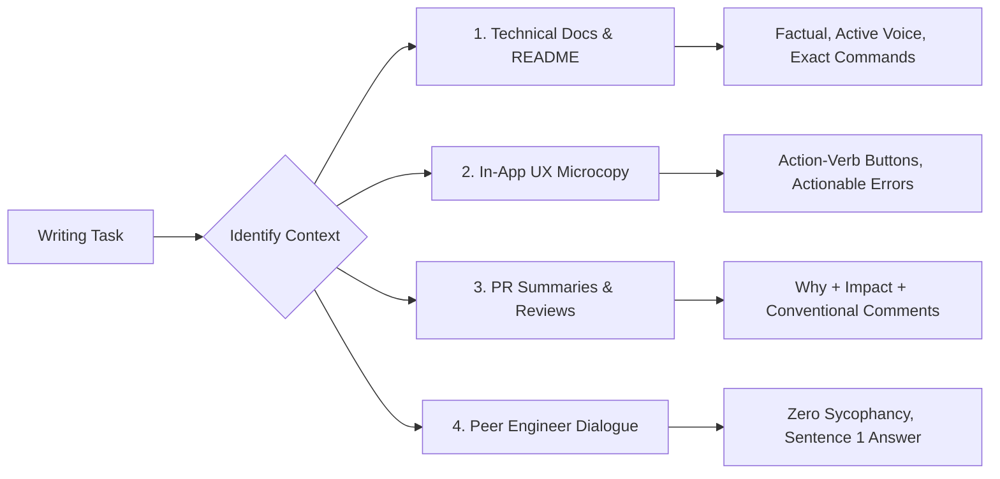

# Human Technical Writing & Anti-AI Prose Skill

Use this skill whenever drafting, reviewing, or editing **technical documentation (README.md, architecture specs)**, **in-app UX microcopy (buttons, error dialogs, empty states)**, **pull request descriptions & code reviews**, or communicating as an AI assistant. It eliminates robotic AI-tell prose, corporate hyperbole, and conversational sycophancy.

---

## 1. The 4 Operational Writing Contexts

---

## 2. Execution Guidelines by Context

### Context 1: Technical Documentation & `README.md`
- **First-Sentence Rule:** Sentence 1 must define the system's function, runtime/stack, and core architectural pattern without promotional puffery.
- **Negative Constraints:**
  - Never use adjectives like *"revolutionary"*, *"blazingly fast"*, *"seamless"*, or *"robust"*.
  - Omit decorative emojis from headers (no 🚀, ✨, 🛠️).
  - Never use negative parallelism (*"It's not just a tool, it's an ecosystem..."*).
- **Grounding:** Commands must match real scripts in `package.json`, `Makefile`, or repository configurations.

### Context 2: In-App UX Microcopy (Buttons, Errors, Empty States)
- **Action-Verb Buttons:** Pair a specific transitive verb with its object:
  - ❌ *"Submit"*, *"OK"*, *"Yes/No"*, *"Proceed"*
  - ✅ *"Save Changes"*, *"Delete Account"*, *"Export Report (CSV)"*, *"Cancel"*
- **Actionable Error Messages:** Always provide a two-part factual statement:
  $$\text{Error Message} = [\text{Factual Failure Cause}] + [\text{Concrete Actionable Remediation}]$$
  - ❌ *"Error 422: Invalid input!"*
  - ✅ *"Failed to save configuration because port 4010 is already in use. Update the port value in `.env` and save again."*
- **Empty States:** 1 concise sentence explaining utility + exactly 1 Primary CTA button.
- **Platform Verbs:**
  - Desktop & Web: Use *"Click"* or keyboard shortcuts (e.g., `Press Enter`).
  - Mobile: Use *"Tap"* or *"Swipe"*. **Never use *"Click"*** on touchscreens.

### Context 3: Pull Request Descriptions & Code Reviews
- **Explain the "Why", Not the Diff:**
  1. *Problem Statement & Context*
  2. *Architectural Approach & Trade-offs*
  3. *Verification & Test Scenarios*
- **Conventional Comments for Code Reviews:** Prefix all review findings with severity labels:
  - `blocking:` Critical bug, data corruption risk, or race condition that must be resolved before merge.
  - `security:` Vulnerability, secret exposure, or missing sanitization.
  - `suggestion:` Concrete improvement with proposed code diff.
  - `nit:` Non-blocking formatting or naming cleanup.
  - `question:` Clarification regarding non-obvious business logic.

### Context 4: Peer Engineer Dialogue (IDE Chat & Terminal)
- **Zero Sycophancy / Filler:** Never begin responses with *"Great question!"*, *"Certainly!"*, *"You're absolutely right!"*, or end with *"Hope this helps!"*.
- **Sentence 1 Delivery:** Deliver the technical answer, root cause analysis, or executed file diff in sentence 1.
- **Objective Peer Tone:** Speak like an experienced Senior Engineer. If the developer's architecture has a flaw or risk, state the trade-off directly with line-numbered evidence from the codebase.

---

## 3. Negative Constraint Index (Banned Word List)

| Banned Word / Pattern | What to Use Instead |
| :--- | :--- |
| `delve` | Analyze, inspect, examine |
| `tapestry` | Architecture, structure, workflow |
| `seamless` | Automated, integrated, friction-free |
| `robust` | Resilient, fault-tolerant, tested |
| `revolutionary` | Omit completely; state actual benchmark metrics |
| `blazingly fast` | State measured latency (e.g., `< 50ms P99`) |
| `testament` | Evidence, verified result |
| `crucial` | Essential to prevent [specific impact] |
| Consecutive em-dashes (`—`) | Use periods, commas, or parentheses |
| Negative parallelism (*"Not just X, but Y..."*) | State directly what the system does |

---

## 4. Pre-Flight Writing Checklist

Before publishing documentation, UI copy, or code reviews:
- [ ] Banned words (`delve`, `tapestry`, `seamless`, `robust`, etc.) are eliminated.
- [ ] Negative parallelisms (*"not just X, but also Y"*) are removed.
- [ ] Buttons use action-verb pairs (*"Save Changes"* vs *"Submit"*).
- [ ] Error messages state both the factual failure and the concrete resolution.
- [ ] Mobile text uses touch verbs (*"Tap"* / *"Swipe"* instead of *"Click"*).
- [ ] Sycophancy and template sign-offs are stripped from conversation output.
