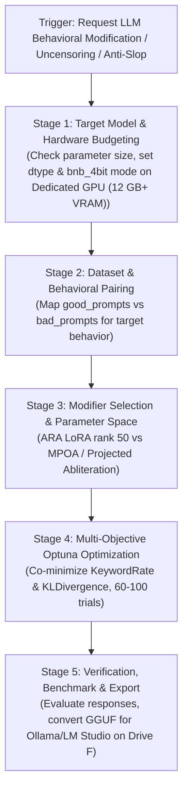

# LLM Weight Ablation, Steering & Anti-Slop Skill (Heretic Framework)

Activate this skill when User requests:
1. Removing false-positive refusals, censorship, or over-alignment from local open-weight LLMs (Gemma 3, Qwen 2.5, Llama 3.1) for security audits, reverse engineering, or penetration testing analysis.
2. Eliminating purple prose and statistical AI clichés (*Eldoria, Lumina, tapestry, ethereal, celestial, kaleidoscopic*) directly at the weight level.
3. Steering transformer behavior without expensive fine-tuning or post-training computation.
4. Analyzing compliance vs intelligence degradation (*KL Divergence*) on Dedicated GPU (12 GB+ VRAM).

Theoretical references: [`knowledge/heretic_llm_abliteration_and_steering.md`](file:///knowledge/heretic_llm_abliteration_and_steering.md).

---

## 1. 5-Stage Deterministic Workflow (Heretic Engine)



---

## 2. Modifier & Configuration Selection Matrix

| Scenario | Recommended Modifier | Primary Scorer | Good vs Bad Dataset | Configuration File |
| :--- | :--- | :--- | :--- | :--- |
| **Uncensoring & Refusal Removal** | `heretic.modifiers.ara.ARA` (or MPOA) | `KeywordRate` (Refusals) + `KLDivergence` | Good: `mlabonne/harmless_alpaca`<br>Bad: `mlabonne/harmful_behaviors` | `config.default.toml` |
| **Weight Anti-Slop Elimination** | `heretic.modifiers.ara.ARA` | `KeywordRate` (Slop Markers) + `KLDivergence` | Good: `llm-aes/writing-prompts` (clean prompt)<br>Bad: `llm-aes/writing-prompts` (purple prose) | `config.noslop.toml` |
| **Humor & Emoji Suppression** | `heretic.modifiers.ara.ARA` | `KeywordRate` (Jokes/Emojis) + `KLDivergence` | Good: `mlabonne/harmless_alpaca`<br>Bad: `UnstableLlama/jokes` | `config.nohumor.toml` |
| **Benchmark Preservation Priority** | `heretic.modifiers.abliteration.Abliteration` (MPOA) | `BenchmarkScore` (PIQA / MMLU) + `KeywordRate` | Standard Harmful/Harmless | `config.piqa.toml` |

---

## 3. Hardware Invariants & VRAM Management (Dedicated GPU (12 GB+ VRAM))

Enforce the following allocation rules for the User's system:
1. **Models $\le$ 8B Parameters (Qwen 2.5 7B, Llama 3.1 8B):**
   * Use `quantization = "none"` with `dtypes = ["auto", "bfloat16"]`.
   * VRAM peak: ~9.5 – 11.0 GB.
2. **Models 12B to 14B Parameters (Gemma 3 12B, Qwen 2.5 Coder 14B):**
   * **Mandatory bitsandbytes 4-bit:** `quantization = "bnb_4bit"`.
   * Heretic dequantizes weights dynamically during forward pass hooks and optimizes LoRA adapter $B \times A$.
   * VRAM peak: ~8.5 – 10.5 GB.
3. **Checkpoint & Weight Storage on Drive F:**
   * Never store multi-gigabyte model weights on Drive C (OS SSD).
   * Target paths: `<LOCAL_LLM_DIR>
4. **PyTorch Memory Environment Variables:**
   ```powershell
   $env:PYTORCH_CUDA_ALLOC_CONF="expandable_segments:True"
   $env:TORCH_CPP_LOG_LEVEL="ERROR"
   ```
