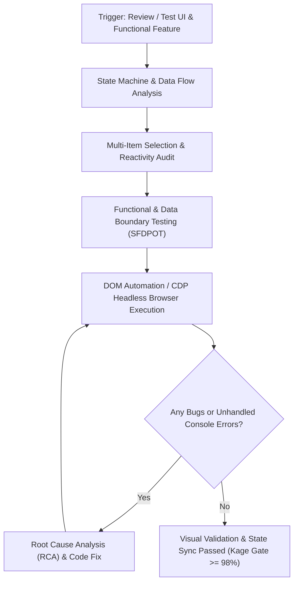

# Software QA, UI State Synchronization, & Test Automation Skill

Use this skill when testing, conducting QA audits, or verifying desktop, web, or mobile applications. Eliminates the *"build pass but UI fails"* syndrome (including *partial state updates* and *stale state bindings*) by deterministically verifying DOM mutations and state transitions.

---

## 1. Deterministic QA Testing Loop



---

## 2. UI State Synchronization Rules

When testing or implementing multi-item selection components (e.g., physical disk tabs, account dropdowns, master-detail lists):

1. **State & Reactivity Audit:**
   - Strictly prohibit relying on static local state that falls out of sync with selected items.
   - Verify zero hardcoded indices (e.g., `items[0]`) in detail sub-components, health badges, alert banners, or metrics panels.
   - Preserve DOM ID integrity: avoid destructive `innerHTML` replacements that strip IDs required by active controllers.

2. **Dynamic Selection Verification (Tab Test Matrix):**
   - **Step 1:** Select Item 1 -> Record snapshot (Name, Serial, Capacity, Health Badge Color, Banner, Attribute Table).
   - **Step 2:** Click Item 2 through N -> Verify **EVERY** field dynamically mutates to match the active item's payload.
   - **Step 3:** Re-select Item 1 -> Verify Item 1 restores accurately without residual state from previous selections.

3. **Console & Network Hygiene:**
   - Monitor browser console logs: enforce zero unhandled exceptions (`TypeError`, `ReferenceError`).
   - Monitor API/IPC payloads: ensure invocation parameters (e.g., `disk_index`, `start_block`) reflect the active item.

---

## 3. SFDPOT Heuristics (James Bach / Ministry of Testing)

Apply 6 test dimensions:
- **Structure:** Bundled assets, binary scripts, dependencies, HTML templates.
- **Function:** Metric computations, maintenance routines (TRIM/CHKDSK), i18n translations, theme toggling.
- **Data:** Empty states, 0-byte drives, unusual serial formats, unpartitioned disks, MASKED vs NORMAL status.
- **Platform:** Windows desktop app environments (Edge/Chrome App Mode, PyInstaller), display scaling, lifecycle hooks.
- **Operations:** Rapid tab switching, rapid scan button clicks, cancel/pause, terminal log clearing.
- **Time:** Heartbeat timeouts (prevent zombie processes), block I/O latency, async render timing.

---

## 4. Automated Testing Execution via Microsoft Edge Headless & CDP

Launch application locally, then run automated headless tests:
```powershell
& "C:\Program Files (x86)\Microsoft\Edge\Application\msedge.exe" --headless=new --remote-debugging-port=9222 "http://127.0.0.1:5550"
```
Use WebSocket or HTTP CDP bridge to simulate clicks, query DOM state, and capture console errors headlessly.
