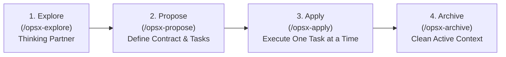

# Spec-Driven Development (OpenSpec Protocol)

> **Core Philosophy:** "Spec first. Code second. Boundaries first."  
> Review intent (specifications and proposals) before writing code. Eliminate large, unconstrained PR diffs and keep agents strictly within their scoped directories.

---

## 1. The 4-Phase Development Loop

### Phase 1: Explore (`/opsx-explore`)
- **Stance:** Collaborative thinking and investigation.
- **Rules:**
  - Inspect existing codebase patterns, architecture, and constraints.
  - **NEVER write or edit application code during exploration.**
  - Resolve blocking decisions before downstream details.
  - Ask focused, single-topic questions when business requirements are ambiguous.

### Phase 2: Propose (`/opsx-propose`)
- Create change artifacts under `openspec/changes/<change-name>/`:
  1. `proposal.md`: Problem statement, why now, and high-level delta.
  2. `design.md`: Technical boundaries, architecture diagrams, and sequence flows.
  3. `specs/`: Functional requirements and validation criteria.
  4. `tasks.md`: Sequenced, atomic checklist of verifiable tasks (`done / planned`).
- **Boundaries First:** Define shared interface contracts (e.g. `contract.ts`, DTOs, endpoint schemas) before implementing inner logic.

### Phase 3: Apply (`/opsx-apply`)
- Sequentially execute tasks from `tasks.md`.
- **Scope Lines for Agents ("Agents Stay in Their Folder"):**
  - Confine code edits strictly to the target feature folder (e.g., `src/games/integrity/` or `services/payment/`).
  - Never mutate shared shell files or neighboring modules without explicit multi-folder authorization.
- Execute one task $\rightarrow$ run check $\rightarrow$ verify pass $\rightarrow$ mark `[x]` in `tasks.md`.

### Phase 4: Archive (`/opsx-archive`)
- **Archive as You Go:** Once all tasks in `tasks.md` pass verification, move the change to `openspec/changes/archive/YYYY-MM-DD-<change-name>/`.
- Cleans active workspace context, preventing obsolete specifications from consuming tokens in subsequent turns.

---

## 2. Invariants & Lessons Learned

1. **Spec the Seams First:** Always establish interfaces, route parameters, and score/status schemas before building inner components.
2. **Write Decisions Back:** When implementation realities require departing from the initial plan, update `design.md` and `proposal.md` immediately to prevent spec drift.
3. **Right-Size the Ceremony:** For small, 1-to-2 line bug fixes, do not construct monolithic multi-file specs. Match procedural rigor to operational risk.
4. **Behavior vs. Feel:** Spec the determinism, data flow, and error states; tune animations, visual polish, and tactile UX through interactive execution.
