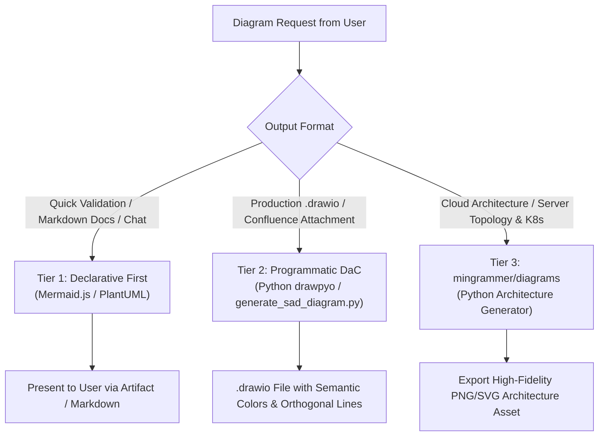
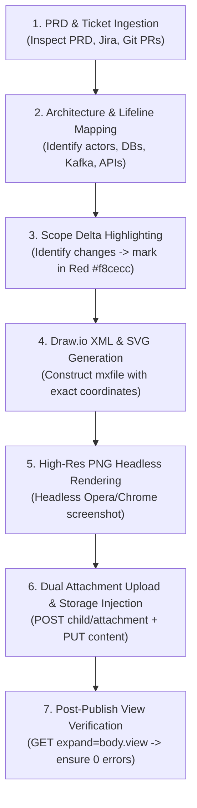

# System Analyst Diagramming & Diagram-as-Code (DaC) Skill

Equips Gemi to act as an elite **System Analyst Designer (SAD)** assistant, delivering precise, professional, and zero-hallucination diagrams for technical specifications (FRD, architecture reviews, and sprint planning) across Draw.io, Confluence, and repository documentation.

---

## 1. Trigger Context

Activate this skill whenever User requests:
- Designing or reviewing **Activity Diagrams**, **Swimlane Diagrams**, or **Process Flowcharts**.
- Creating **User Story Mapping Grids** or backlog release slices.
- Drafting **System Architecture Diagrams**, **C4 Models (Context/Container/Component)**, or microservice interaction topologies.
- Writing **Sequence Diagrams** or **Development Detail (Section 5 FRD)** for API endpoints.
- Generating `.drawio` files, converting text/Mermaid to Draw.io, or embedding diagrams into **Confluence**.

---

## 2. Diagram-as-Code (DaC) Decision Framework

Never attempt to manually guess coordinates in raw Draw.io XML (`<mxGraphModel>`). Apply the 3-tier strategy:



| Tier | Engine / Tool | Best Use Case | Primary Advantage |
| :--- | :--- | :--- | :--- |
| **Tier 1 (Declarative)** | `Mermaid.js` / `PlantUML` | Activity Diagrams, Sequence Diagrams, State Machines in chat / PR artifacts. | Fast iteration, natively supported by Confluence (`Insert > Advanced > Mermaid`). |
| **Tier 2 (Programmatic DaC)** | Python `drawpyo` / `generate_sad_diagram.py` | Physical `.drawio` attachments for Confluence, complex Flowcharts, User Story Mapping grids. | Eliminates node overlap, mathematical grid snapping, structured XML generation. |
| **Tier 3 (Cloud Architecture)** | Python `diagrams` (`mingrammer/diagrams`) | Infrastructure topologies, Kubernetes deployments, on-premise & hybrid cloud designs. | Official cloud icons (AWS/GCP/Azure/K8s), sharp anti-burik visual fidelity. |
| **Tier 4 (Official MCP Integration)** | `jgraph/drawio-mcp` / `sparklabx/drawio-ai-kit` | Official Draw.io MCP server (`npx @drawio/mcp`) and Antigravity plugin. | Native `.drawio` creation, embedded XML PNG exports (`--embed-diagram`), structural validation. |

---

## 3. Sequence Diagram Architecture Standards (Section 5 FRD)

When User asks to design or document API sequences, microservice interactions, or SDK integrations:

### 3.1. Core Sequence Guardrails
1. **Participant Declaration & Chronology (Left to Right):**
   - Explicitly declare participants at the top in chronological order:
     `Actor / User` $\rightarrow$ `Client App (Frontend/Mobile)` $\rightarrow$ `Internal Backend / Gateway (API Gateway/onboarding_service)` $\rightarrow$ `Supporting SDK / Local Library` $\rightarrow$ `External Cloud / Third Party / Database`.
   - Use clean alphanumeric identifiers with display aliases (e.g., `participant App as "Your App"`).
2. **Arrow Semantics:**
   - `->>` (Solid): Synchronous HTTP/gRPC requests, method/function calls, or trigger events.
   - `-->>` (Dashed): Return values, HTTP responses, or callback listeners.
   - `A->>A:` (Self-Arrow): Crucial internal processing (decryption, frame capture, validation).
3. **Dual-Context Labeling (Business Verb + Technical Contract):**
   - Combine business intent and technical parameters concisely (max 8–10 words per line).
   - *Example:* `Upload metaData and request sdkToken / serverParamInfo`
   - *Example:* `startCloudOcr(activity, OcrCloudConfig, listener)`
   - Never use vague labels like *"Call API"* or dump raw multi-line JSON payloads directly on arrows.
4. **Error Codes & Exception Mapping:**
   - Always map negative cases, HTTP error codes, and vendor codes using `Note over` or `Note right of` directly under the response arrow:
     `Note right of SDK: Error Case: FailedOperation.ImageNoSpecifiedCard`
     `Note over App,SDK: Error Code: 400101`

### 3.2. Draw.io Anti-Error Parser Guardrails
To prevent Draw.io parser crashes when pasting Mermaid into Confluence:
- **Participant IDs:** Never use hyphens or symbols without quotes (`participant Your-App` $\rightarrow$ use `participant App as "Your App"`).
- **Single Statement per Line:** Never chain statements with semicolons. Always use clean newlines.
- **No Raw Braces in Labels:** Replace curly braces `{}` or `::` with standard parentheses `()` or wrap the label in quotes.
- **Restricted HTML:** Use `<br/>` strictly for line breaks; avoid nested HTML tags.

---

## 4. Semantic Visual Standards & Styling Tokens (Draw.io)

### 4.1. Semantic Color Tokens
```xml
<!-- 1. Start / Success / Terminal OK (Green) -->
fillColor=#d5e8d4;strokeColor=#82b366;fontColor=#274e13;

<!-- 2. Process / Action / Internal Microservice (Blue) -->
fillColor=#dae8fc;strokeColor=#6c8ebf;fontColor=#1c3b70;

<!-- 3. Decision / Condition Branching (Yellow/Gold) -->
fillColor=#fff2cc;strokeColor=#d6b656;fontColor=#7f6000;

<!-- 4. End / Error / Exception / Reject (Red) -->
fillColor=#f8cecc;strokeColor=#b85450;fontColor=#660000;

<!-- 5. Database / Persistence / Cache (Purple) -->
fillColor=#e1d5e7;strokeColor=#9673a6;fontColor=#351c75;

<!-- 6. Third Party / External Vendor (Orange) -->
fillColor=#ffe6cc;strokeColor=#d79b00;fontColor=#783f04;
```

### 4.2. Mandatory Connector / Edge Style
All relation edges must enforce orthogonal routing to avoid slicing through intermediate shapes:
```xml
edgeStyle=orthogonalEdgeStyle;rounded=0;orthogonalLoop=1;jettySize=auto;html=1;strokeColor=#565656;
```

---

## 5. The 3 Confluence & Draw.io Integration Workflows

- **Workflow 1 (Mermaid Paste):** In Confluence, add `/drawio` macro $\rightarrow$ **Arrange > Insert > Advanced > Mermaid...** $\rightarrow$ paste code $\rightarrow$ fully editable shapes.
- **Workflow 2 (File Import):** Save as `squad-<type>-<feature>.drawio` $\rightarrow$ In Draw.io macro: **File > Import from > Device**.
- **Workflow 3 (Editable PNG):** Export via Draw.io CLI with `--embed-diagram` $\rightarrow$ generates `.drawio.png` with embedded XML.

---

## 6. CLI Helper Tools & Diagnostics

- **Syntax Validation & Self-Correction:**
  ```bash
  npx @mermaid-js/mermaid-cli -i diagram.mmd -o diagram.png -t dark
  ```
  *Diagnostic feedback:* If a syntax error occurs, the compiler reports the exact line number for instant self-correction.
- **Python Generator:**
  ```bash
  python ~/.gemini/scripts/generate_sad_diagram.py --type flowchart --title "PIN Verification Flow" --out "squad-flowchart-pin.drawio"
  ```
- **Confluence Draw.io Tool (Publish, Revision Update & Verification):**
  ```bash
  # One-shot publish:
  python ~/.gemini/scripts/confluence_drawio_tool.py publish \
    --page-id <page_id> \
    --xml <path_to_diagram.xml> \
    --png <path_to_rendered.png> \
    --name <diagram_name_without_extension> \
    --type activity

  # Pinpoint update macro revision (fixes 'Stuck Revision' trap):
  python ~/.gemini/scripts/confluence_drawio_tool.py set-revision \
    --page-id <page_id> \
    --name <diagram_name> \
    --revision 2

  # Deep verification of rendered view HTML:
  python ~/.gemini/scripts/confluence_drawio_tool.py verify --page-id <page_id>
  ```
- **Official Draw.io MCP:**
  ```bash
  # Antigravity plugin:
  agy plugin install https://github.com/jgraph/drawio-mcp/tree/main/plugins/antigravity
  # Direct NPX MCP server:
  npx @drawio/mcp
  ```

---

## 7. FRD Activity Diagram Standard Operating Procedure (SOP)

When User requests creating or enhancing the **Activity Diagram** for a Functional Requirement Document (FRD) in Confluence:

### 7.1. Structural Invariants & Lifeline Architecture
Activity Diagrams in Enterprise Banking / Corporate Services FRDs follow a **UML Lifeline / Multi-Phase Sequence Hybrid**:
1. **Vertical Lifelines:** Represent all internal and external systems as vertical lifelines (`shape=umlLifeline;perimeter=lifelinePerimeter;whiteSpace=wrap;html=1;container=1;collapsible=0;size=40;`):
   - User / Channels: `Customer Support Portal`, `Web Registration`, `Corporate Mobile App`
   - Orchestration / Gateway: `customer-onboarding-service`
   - Cache / State: `Redis (Cache & OTP)`
   - Relational Storage: `MySQL DB (onboarding_db)`
   - Core Banking / Microservices: `Core Banking Platform`, `Microservice Ledger`
   - Asynchronous Messaging: `Kafka (Notification / Event Streaming)`
2. **Phase Partitioning:** Group functional steps horizontally into distinct lifecycle phases (e.g., *Phase 1: Verification & Inquiry*, *Phase 2: Activation Link Dispatch*, *Phase 3: Web Landing & Deeplink Resolution*, *Phase 4: OTP Validation & Finalization*).
3. **Delta/Modification Highlighting (Red Boxes):**
   - New or modified logic must be bounded by distinct dashed red containers:
     `fillColor=#fee2e2;strokeColor=#ef4444;strokeWidth=2;strokeDasharray=6 4;fillOpacity=0.6;`
   - With an explicit solid title badge:
     `fillColor=#ef4444;fontColor=#ffffff;fontStyle=1;`
   - Explanatory subtitle paragraph preceding the diagram: `<p>Perubahan pada section yg berwarna merah</p>`.

### 7.2. Confluence Macro Storage Contract
The diagram must be wrapped in an `expand` macro with the title `acitivy-diagram` (or `activity-diagram`) enclosing a native `drawio` macro:
```xml
<h2>Activity Diagram</h2>
<p>Perubahan pada section yg berwarna merah</p>
<ac:structured-macro ac:name="expand" ac:schema-version="1">
  <ac:parameter ac:name="title">acitivy-diagram</ac:parameter>
  <ac:rich-text-body>
    <p>
      <ac:structured-macro ac:name="drawio" ac:schema-version="1">
        <ac:parameter ac:name="border">true</ac:parameter>
        <ac:parameter ac:name="diagramName">{diagram_name}</ac:parameter>
        <ac:parameter ac:name="simpleViewer">false</ac:parameter>
        <ac:parameter ac:name="width">800</ac:parameter>
        <ac:parameter ac:name="links">auto</ac:parameter>
        <ac:parameter ac:name="tbstyle">top</ac:parameter>
        <ac:parameter ac:name="diagramDisplayName" />
        <ac:parameter ac:name="lbox">true</ac:parameter>
        <ac:parameter ac:name="diagramWidth">{canvas_width}</ac:parameter>
        <ac:parameter ac:name="height">{canvas_height}</ac:parameter>
        <ac:parameter ac:name="revision">1</ac:parameter>
        <ac:parameter ac:name="" />
      </ac:structured-macro>
    </p>
  </ac:rich-text-body>
</ac:structured-macro>
<p><br /></p>
```

### 7.3. Dual Attachment Publishing Protocol
Confluence Draw.io integration strictly requires **two page attachments** uploaded to `/rest/api/content/{page_id}/child/attachment`:
1. `{diagram_name}`: Diagram XML with Content-Type `application/vnd.jgraph.mxfile`. **CRITICAL: The attachment title must have NO file extension** so it matches `diagramName` exactly.
2. `{diagram_name}.png`: High-resolution rendered image with Content-Type `image/png`. Rendered via headless browser (Opera/Chrome) screenshot at exact canvas dimensions.

### 7.4. The 7-Step Activity Diagram Production Flow


### 7.5. Tool & MCP Ecosystem Matrix
| Phase | Tool / MCP | Purpose |
| :--- | :--- | :--- |
| **Requirements** | `jira` MCP, `confluence` MCP | Fetch user stories, acceptance criteria, and reference FRD diagrams. |
| **Code Inspection** | `bitbucket` MCP, local `git` | Analyze Pull Requests and commit diffs across microservice repos (`customer-onboarding-service`, `web-registration`). |
| **Database Verification**| `database-query` skill (`db_query.py`) | Inspect live dev tables (`tbl_onboarding_nds`, `tbl_parameters`) to verify schema additions. |
| **Diagram Generation** | Python `drawpyo` / `generate_sad_diagram.py` | Generate syntactically valid Draw.io XML with proper lifelines, markers, and geometry. |
| **Headless Rendering** | Opera / Chrome Headless CLI | Render anti-burik PNG from SVG preview in < 2 seconds. |
| **Publishing & Storage**| `confluence_drawio_tool.py` / Confluence REST API | Upload dual attachments (`nocheck`), inject macros, update revisions, and verify view. |

---

## 8. FRD Architecture Diagram SOP ("Anti-Ribet" Component Topology)

When User asks to design or simplify the **Architecture Diagram** (Section 2 FRD):

### 8.1. Anti-Pattern: The Over-Engineered 5-Layer Diagram
- Never generate 40-box 5-layer swimlanes (Client, API Gateway, Core, External, Storage) with multi-line paragraphs.
- Engineers and product stakeholders need rapid, immediate comprehension without visual exhaustion.

### 8.2. Gold Standard: Clean 4-Quadrant Component Topology (`521x508`)
Modeled directly on the Internal Platform Onboarding standard (`page_id=123456700`):
1. **Dimensions:** `diagramWidth="521"`, `height="508"`.
2. **Component Topology:**
   - **Top-Left (Q1):** `[Partner Server]` $\leftrightarrow$ `[API_GATEWAY Gateway (#f8cecc)]`
   - **Left (Q3):** `[API Gateway (API Gateway)]` $\rightarrow$ `[customer-onboarding-service]`
   - **Center:** `[customer-onboarding-service (Core Microservice)]`
   - **Top-Right (Q2):** `[customer-onboarding-service]` $\leftrightarrow$ `[Redis (Cache)]`
   - **Right (Q4):** `[customer-onboarding-service]` $\rightarrow$ `[document-signing-service / partner-ca]`
   - **Bottom (Q4):** `[customer-onboarding-service]` $\leftrightarrow$ `[db onboarding_db]`

### 8.3. Confluence Storage XML Contract
```xml
<h2>Architecture Diagram</h2>
<ac:structured-macro ac:name="expand" ac:schema-version="1">
  <ac:parameter ac:name="title">Click here to show architecture diagram...</ac:parameter>
  <ac:rich-text-body>
    <p>
      <ac:structured-macro ac:name="drawio" ac:schema-version="1">
        <ac:parameter ac:name="border">true</ac:parameter>
        <ac:parameter ac:name="diagramName">{diagram_name}</ac:parameter>
        <ac:parameter ac:name="simpleViewer">false</ac:parameter>
        <ac:parameter ac:name="links">auto</ac:parameter>
        <ac:parameter ac:name="tbstyle">top</ac:parameter>
        <ac:parameter ac:name="lbox">true</ac:parameter>
        <ac:parameter ac:name="diagramWidth">521</ac:parameter>
        <ac:parameter ac:name="height">508</ac:parameter>
        <ac:parameter ac:name="revision">{revision}</ac:parameter>
      </ac:structured-macro>
    </p>
  </ac:rich-text-body>
</ac:structured-macro>
```

---

## 9. Confluence Troubleshooting & Revision Synchronization SOP

### 9.1. The "Stuck Revision" Trap
- **Problem:** New attachment version (v2, v3) is uploaded, but Confluence page still displays the old diagram.
- **Root Cause:** Confluence Draw.io macro explicitly caches `<ac:parameter ac:name="revision">1</ac:parameter>`.
- **Solution:** Execute:
  ```bash
  python ~/.gemini/scripts/confluence_drawio_tool.py set-revision \
    --page-id <page_id> \
    --name <diagram_name> \
    --revision <new_version>
  ```

### 9.2. Attachment Update Endpoint Invariant
- Do not POST duplicates to `/child/attachment` (causes HTTP 400).
- Always use `POST /rest/api/content/{page_id}/child/attachment/{attachment_id}/data` with header `X-Atlassian-Token: nocheck`.

### 9.3. Visual Quality Gate via Apple Silicon OCR
- Always run native macOS OCR to verify all text labels before publishing:
  ```bash
  ocr path/to/diagram.png
  ```
- Ensure zero character cutoffs, clipped swimlane headers, or misaligned text labels.
