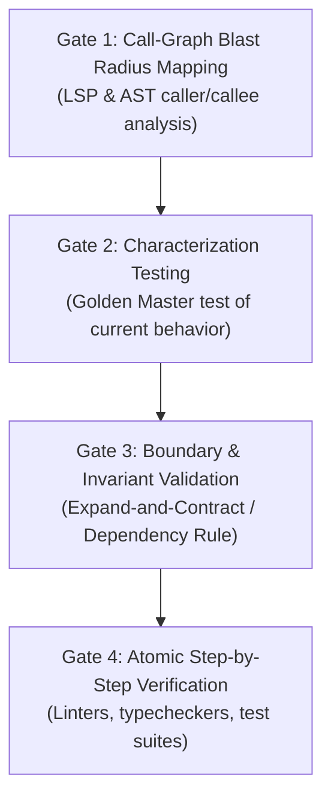

# Zero-Regression Refactoring Protocol

> **Core Philosophy:** "Never modify code blindly. Map the call-graph blast radius, lock existing behavior with characterization tests, maintain architectural boundaries via Expand-and-Contract, and verify each step with static diagnostics."

---

## 1. When to Activate This Skill

Activate this skill whenever:
1. User asks to refactor a class, service, repository, or architecture layer.
2. Modifying shared utilities, core domain models, or cross-cutting middleware.
3. Migrating APIs, database schemas, or Kafka event payload schemas.
4. Upgrading language versions, libraries, or architectural patterns (e.g. MVC to Clean Architecture).

---

## 2. The 4 Verification Gates

Refactoring code without passing these 4 gates in strict sequential order is prohibited:

### Gate 1: Call-Graph Blast Radius Mapping
1. Query symbol references and implementations using LSP (`find_referencing_symbols`, `find_implementations`) or AST search.
2. Categorize the impact along 3 dimensions:
   - **Direct Callers:** All functions, methods, and unit tests directly invoking the target symbol.
   - **Indirect Contracts:** HTTP endpoints, Kafka event producers/consumers, Redis keys, or database tables impacted.
   - **Cross-Repo Consumers:** Check remote Bitbucket repositories that consume the package or interface.
3. Present the Blast Radius Ledger to User before mutating any code.

### Gate 2: Characterization Testing (Golden Master)
1. Verify if test coverage already locks the target symbol's behavior.
2. If tests are absent or incomplete, write **Characterization Tests** that capture:
   - Happy path inputs and outputs.
   - Boundary inputs (null, empty, negative, max values).
   - Error handling and exception states.
3. Run characterization tests against the **unmodified legacy code** until they PASS. These tests serve as the immovable baseline.

### Gate 3: Boundary & Invariant Validation
1. **Dependency Inversion Check:** Ensure that Domain/Core logic never depends on infrastructure, frameworks, or database drivers.
2. **Contract Preservation:** Never perform breaking changes on public APIs or Kafka payloads in a single mutation.
3. **The Expand-and-Contract Pattern:**
   - *Phase 1 (Expand):* Add the new signature, function, or field alongside the existing one.
   - *Phase 2 (Migrate):* Incrementally switch callers and consumers to the new symbol.
   - *Phase 3 (Contract):* Deprecate and remove the obsolete symbol once all callers are verified.

### Gate 4: Atomic Step-by-Step Verification
1. Execute refactoring in the smallest safe increments (one function or one file at a time).
2. Execute programmatic diagnostics immediately after each edit:
   - **Go:** `golangci-lint run ./...` & `go test -race ./...`
   - **TypeScript / React Native:** `pnpm tsc --noEmit` & `pnpm vitest / jest`
   - **PHP:** `vendor/bin/phpstan analyse` & `vendor/bin/phpunit`
   - **Python:** `ruff check .` & `mypy .` & `pytest`
   - **Swift:** `swiftlint` & `xcodebuild test`
   - **Kotlin / Java:** `./gradlew lint` & `./gradlew test`
3. Never proceed to the next refactoring step until current diagnostics and test suites are 100% green.

---

## 3. Anti-Patterns & Strict Prohibitions

1. **No Big-Bang Refactoring:** Never refactor multiple layers (e.g. Controller + Service + Repository) simultaneously in a single unverified commit.
2. **No Deletion of Passing Tests:** Never delete or weaken existing test assertions to make refactored code pass.
3. **No Unchecked Schema Mutations:** Never change database column types or drop columns without a dual-phase migration strategy.
